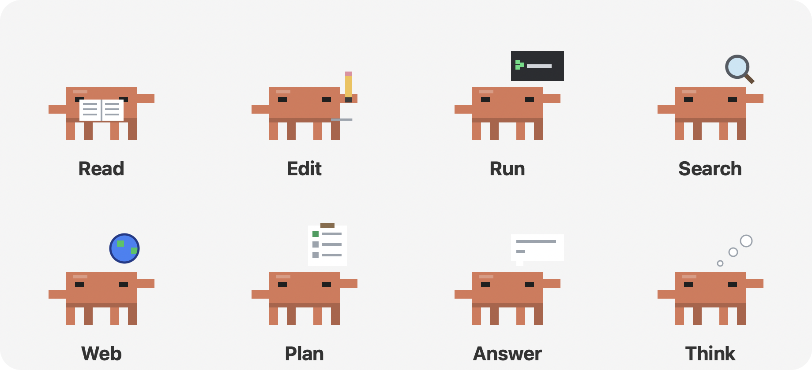
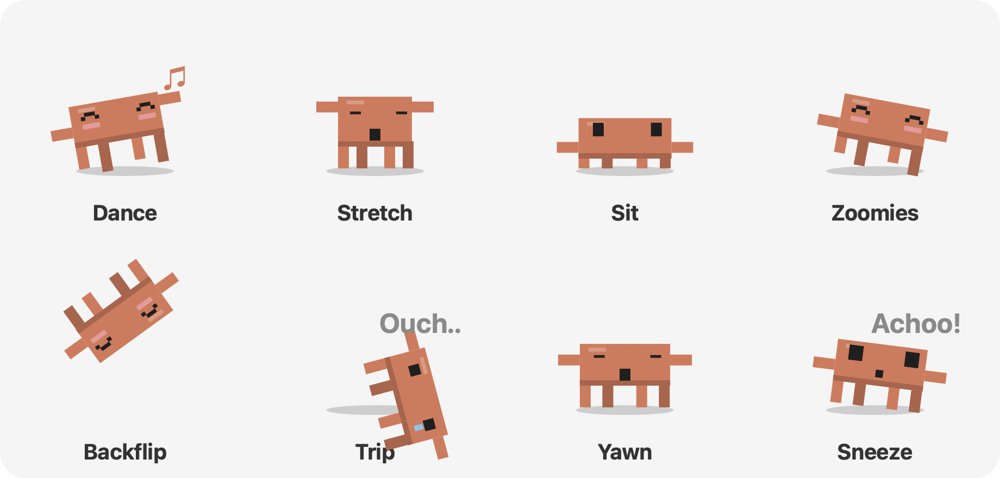

# Claude Buddy

[한국어](README.md) | **English** | [日本語](README.ja.md) | [简体中文](README.zh-CN.md) | [Español](README.es.md)

> A macOS desktop pet that walks around your screen and shows **what Claude Code, Codex and Antigravity are doing right now**


A pixel-art character inspired by the Claude mascot walks along the bottom of your screen and on top of other app windows. When Claude Code starts working, it shows the current task above its head. When subagents run, small characters pop out and work alongside it. You can also pet it, throw it, play ball, give it snacks and run a focus timer together. Ask it a question and it answers briefly through your signed-in Claude, Codex or Antigravity CLI. The interface is available in 한국어, English, 日本語, 简体中文 and Español.

---

## Contents

1. [Features](#features)
2. [Requirements](#requirements)
3. [Install and run](#install-and-run)
4. [Build it yourself](#build-it-yourself)
5. [Usage](#usage)
6. [Settings](#settings)
7. [Asking the AI (optional)](#asking-the-ai-optional)
8. [How it works](#how-it-works)
9. [Project structure](#project-structure)
10. [Privacy and data](#privacy-and-data)
11. [Troubleshooting](#troubleshooting)
12. [Known limitations](#known-limitations)
13. [Credits](#credits)

---

## Features

### 1. Live AI agent activity
- A small label above the character shows what Claude Code is doing.

  | Example label | Meaning | Character animation |
  |---|---|---|
  | `New request`, `Thinking` | New message, reasoning or handling tool results | Thought-cloud dots |
  | `Reading · buddy.py (from line 120)` | Reading a file | Reading a book, turning pages |
  | `Editing · buddy.py`, `Writing · new.py` | Editing a file, writing a new file | Drawing lines with a pencil |
  | `Running · (command description)` | Running a terminal command | Blinking cursor in a tiny terminal |
  | `Searching code · 'pattern'`, `Finding files · *.py` | Searching code or files | Circling magnifier |
  | `Web search · (query)`, `Reading web · github.com` | Web search, reading a page | Spinning globe |
  | `Planning` | Updating the to-do list | Ticking off a checklist |
  | `Writing answer` | Writing the reply | Text appearing in a speech bubble |
  | `Subagent · (task name)` | Calling a subagent | Thought-cloud dots |
  | `Needs you · Please answer the question`, `Needs you · Permission needed` | Waiting for your answer or permission | Waves at you, sends a notification |
  | `Done` | The task finished (shown for 8 seconds) | Hops |

  

  The dot on the left of the label is orange while working and green when done.

- While working, the character types in place and shows a **prop animation for the kind of task**, as in the table above. If a step takes longer than 10 seconds, the elapsed time is added to the label (`· 20s`, `· 2m`). The Codex and Antigravity characters do the same.
- **Battery saving**: it draws at 60 fps only while walking or jumping, 20 fps while standing still and 2 fps while hidden. Nothing is redrawn if nothing changed on screen.
- **"Needs you" alert**: when Claude Code is waiting for your answer to a question (AskUserQuestion, plan approval), the character waves, shows "Check this!" and plays a sound with a macOS notification. Waiting for permission isn't written to the session log, so the app assumes it when an edit, write or web-fetch tool has had no result for more than 8 seconds. Shell commands (Bash) are excluded because they can legitimately take a long time.
- **Long task finished**: when a task that took more than a minute finishes, you get a macOS notification, even if you're looking at another app.
- **Usage window**: choose **Usage…** in the menu to open a window with today's output and input tokens, sessions and replies, a bar chart of output tokens for the last 7 days (hover a bar for the exact value) and today's output per project. It only adds up the usage fields in your session logs and sends nothing anywhere.

  
- **A small character appears for each running subagent**, up to six. Each shows its own task above its head and works next to the main character. When a subagent finishes, it shouts "Done!", jumps and walks off screen.
- Click a small character to see that subagent's task and current status in a speech bubble.
- **Other AI agents show up too.** While one is working, its own character appears next to the main one and shows its task, then leaves when done. No API key is needed; the app only reads the activity logs those tools leave on your Mac.

  | Agent | Character | Logs it reads | What it shows |
  |---|---|---|---|
  | Claude Code | Orange (main) | `~/.claude/projects/` session JSONL | File reads and edits, commands, searches, subagents and more |
  | Codex (GPT) | Green body + white ring | `~/.codex/sessions/` session JSONL | New request, thinking, running commands, editing files, writing the answer |
  | Antigravity (Gemini) | Blue body + purple sparkle | `~/.gemini/antigravity-cli/log/`, `~/.gemini/antigravity/log/` | New request, tool steps, done |

### 2. Character behaviour
- **60 fps animation.** It leans forward while walking, lifts its legs in turn and squashes and stretches on landing. Its gaze and tilt follow smoothly.
- **Facial expressions** change with the situation: normal, blinking, happy (^ ^ with blush), surprised, hurt (tears), sleepy, focused and asleep.
- **Things it does on its own**: besides walking, resting, looking around, dozing and jumping onto other windows, it mixes in the moves below. At night it yawns and sleeps more, and does fewer zoomies and backflips.

  | Move | What it looks like |
  |---|---|
  | Dance | Raises its arms in turn, bobs and shows music notes |
  | Stretch | Closes its eyes, reaches up and stretches tall |
  | Sit | Lowers itself to sit and blinks now and then |
  | Zoomies | Runs three times faster than usual |
  | Backflip | Jumps and flips all the way around before landing |
  | Trip | Falls flat on its face, says "Ouch..", then gets up |
  | Yawn | Opens its mouth wide and lifts its arms a little |
  | Sneeze | Breathes in, then lurches forward with "Achoo!" |

  
- **Walks on top of windows**: it uses the top edges of other app windows as platforms and sometimes falls off the end. Parts covered by other windows aren't used.
- **Multiple displays**: it roams across all connected screens.
- **Always on top**: visible whichever app is in front and on every desktop (Space). The background is fully transparent.

### 3. Interaction

| Action | Response |
|---|---|
| Click | Pet it (heart) |
| Double-click | Pet it (heart and a hop) |
| Hover for 2.5 seconds | Pet it |
| Move the cursor close | It stops, looks at the cursor and waves |
| Drag | Pick it up (legs dangle, surprised face) |
| Drag and let go | Throw it. It bounces off walls and floors and says "Ouch.." after a hard landing |
| Right-click | Open the menu (the character stays still while the menu is open) |

**Menu** (right-click or the menu bar icon)

| Menu item | What it does |
|---|---|
| Ask… | Type a question and Claude, Gemini or GPT answers briefly (see [Asking the AI](#asking-the-ai-optional)) |
| Usage… | Window with today's and the last 7 days' Claude Code token usage |
| Give a snack | A cookie drops at the cursor and the character runs over to eat it. You can drag the cookie around |
| Play ball | Throw the ball and it chases it and brings it back toward the cursor, then waits for the next throw |
| Follow cursor | Follows the cursor and jumps onto a window if the cursor is over one |
| Focus timer (25 min) | Shows the time left above its head and focuses with you, then suggests a break |
| Nap for 30 min | Sleeps for 30 minutes |
| Settings | See [Settings](#settings) |

### 4. Everyday reactions
- **Away from the keyboard**: after 5 minutes without input it falls asleep, and greets you with "Welcome back!" when you return.
- **Break reminder**: after 50 minutes of use without a break, it reminds you to stretch.
- **Late night**: between midnight and 5 AM it looks sleepy and suggests calling it a day, once per night.

### 5. Convenience
- **Menu bar icon**: the same features as the right-click menu, plus the current Claude Code task list and **Hide/Show character**.
- **Hides during full screen**: if the front app is full screen (video, presentation), it hides automatically and comes back afterwards.
- **Sounds**: short system sounds for moments like clicks, eating, catching and finishing. You can turn them off in Settings.
- **No Dock icon**: only the menu bar icon appears.

---

## Requirements

- **macOS** on **Apple Silicon (M1 or later)**. The release build is arm64 only. On an Intel Mac, [build it yourself](#build-it-yourself).
- The release app bundles Python and all dependencies, so there's nothing else to install.
- Building it yourself needs **Python 3.10 or later**; `build.sh` installs the dependencies.
  - `pyobjc-framework-Cocoa`: transparent always-on-top windows, drawing, menu bar
  - `pyobjc-framework-Quartz`: other apps' window positions, input idle time
  - `anthropic`: (optional) Claude answers with an API key
  - `certifi`: HTTPS certificate checks in the bundled app

---

## Install and run

### 1. Download

Get `Claude-Buddy-macOS-arm64.zip` from [Releases](https://github.com/Junseung0526/claude-buddy/releases/latest) and unzip it.

### 2. Move it to Applications

Drag `Claude Buddy.app` into the Applications folder.

### 3. Allow it the first time

The app isn't signed or notarized with an Apple developer certificate, so macOS blocks it the first time. Allow it in one of these ways.

- **Option 1 (System Settings)**: open the app once, close the warning, then click **Open Anyway** near the bottom of **System Settings → Privacy & Security**.
- **Option 2 (Terminal)**: remove the download quarantine flag.

  ```bash
  xattr -dr com.apple.quarantine "/Applications/Claude Buddy.app"
  ```

### 4. Start and quit

- Double-click `Claude Buddy.app`. The character appears and an icon shows up in the menu bar. It doesn't appear in the Dock.
- To quit, right-click the character or use the menu bar icon and choose **Quit**.
- To start it at login, add it yourself under **System Settings → General → Login Items** (it isn't added by default).

---

## Build it yourself

You can run it from source or build the app yourself.

```bash
git clone https://github.com/Junseung0526/claude-buddy.git
cd claude-buddy
./build.sh
```

What `build.sh` does:
1. Creates a `.venv` virtual environment (prefers `python3.14`, otherwise `python3`)
2. Installs the `requirements.txt` dependencies and PyInstaller
3. Draws the character into an app icon (`.icns`)
4. Builds **`dist/Claude Buddy.app`** with Python bundled, using PyInstaller (menu-bar-only app, ad-hoc signed)
5. Creates **`dist/Claude-Buddy-macOS-<arch>.zip`** for distribution

Set the version like `VERSION=1.1.0 ./build.sh`. To run without building:

```bash
.venv/bin/python buddy.py          # or .venv/bin/python -m claude_buddy
```

---

## Usage

1. When it starts, the character appears at the bottom of the screen and starts walking.
2. When you start working with Claude Code, Codex or Antigravity, the character stops what it's doing and shows the progress.
3. To ask something, choose **right-click → Ask…**, type your question and press `Enter`. Press `Esc` to close. The answer appears in a speech bubble and closes after 25 seconds, with a note that it was generated by AI and may be wrong.

---

## Settings

Change these under **Settings** in the menu. Values are saved to `~/Library/Application Support/Claude Buddy/settings.json` and kept for the next launch.

| Setting | Key | Options | Default |
|---|---|---|---|
| Size | `scale` | Small / Normal / Large | Normal (`6`) |
| Walking speed | `speed` | Slow / Normal / Fast | Normal (`55`) |
| Sound | `sound` | On / Off | On |
| Notifications (needs you, long tasks done) | `notify` | On / Off | On |
| Language | `lang` | Use system language (`auto`) / 한국어 (`ko`) / English (`en`) / 日本語 (`ja`) / 简体中文 (`zh`) / Español (`es`) | System language (Korean for people who used the app before languages were added) |
| Climb on windows | `windows` | On / Off | On |
| Show agent work | `activity` | On / Off | On |
| Answer model | `ask_provider` | Claude / Gemini / GPT | Claude (`claude`) |

You can also edit `settings.json` directly (takes effect after a restart).

```json
{
 "scale": 6,
 "speed": 55,
 "sound": true,
 "windows": true,
 "activity": true,
 "notify": true,
 "lang": "en",
 "ask_provider": "claude"
}
```

---

## Asking the AI (optional)

**Ask** looks for a way to answer in this order.

| Situation | What happens |
|---|---|
| **Signed in to the chosen model's CLI** (default) | The CLI answers in your chosen language in at most 3 sentences. No API key needed |
| No CLI, but **an API key is set** | Calls the API directly in the same way |
| Neither | Tells you that you need to sign in or add a key |

Answers through a CLI count against your subscription, and take 5–10 seconds because the CLI has to start. No tools are used and no session log is kept, so the question doesn't show up as agent work.

| Choice | CLI used | Sign-in |
|---|---|---|
| Claude | `claude -p` (Haiku) | Claude Code sign-in |
| Gemini | `agy -p` | Antigravity sign-in |
| GPT | `codex exec` | Codex sign-in |

The CLIs are looked up in `PATH`, `~/.local/bin`, `/opt/homebrew/bin` and `/usr/local/bin`.

### Choosing the answer model

Pick it under **Settings → Answer model**. The models below are the ones called with an API key when there's no CLI; all are low-cost models suited to short answers.

| Choice | Model | Get a key |
|---|---|---|
| Claude | `claude-haiku-5-5` | [Anthropic Console](https://console.anthropic.com/) |
| Gemini | `gemini-flash-lite-latest` | [Google AI Studio](https://aistudio.google.com/apikey) |
| GPT | `gpt-5-mini` | [OpenAI Platform](https://platform.openai.com/api-keys) |

### Setting an API key (only without a CLI)

Choose the model, then **Settings → Set (model) API key…**, paste the key and press `Enter`. The key is hidden as you type.

- Keys are stored per model in the **macOS Keychain** (service name `Claude Buddy`), not in the settings file. No restart needed.
- Use **Change API key…** to replace a key and **Delete API key** to remove it.
- Keys are looked up in environment variables (`ANTHROPIC_API_KEY`, `GEMINI_API_KEY`, `OPENAI_API_KEY`) first, then the Keychain.

### Settings that keep costs down

- At most 400 tokens per answer
- Claude: extended thinking off, effort `low`
- GPT: reasoning effort `minimal`

- If a request fails (network, authentication, refusal, renamed model and so on) or the reply is empty, it tells you it couldn't get an answer.
- API use may be billed by each provider.

---

## How it works

### Transparent always-on-top windows
The character, speech bubbles, toys and status labels are all **borderless transparent `NSWindow`s**. They sit at `NSStatusWindowLevel` and join every Space and full-screen auxiliary area, so other apps can't cover them.

> The first version used tkinter (Tk 9), but on macOS the transparent background came out black and the window hid behind other apps, so it moved to PyObjC (Cocoa).

### Detecting Claude Code activity
Claude Code writes its session logs as JSONL files. The buddy **only reads these files, without touching settings or hooks**.

```
~/.claude/projects/<project>/<session ID>.jsonl              ← main session log
~/.claude/projects/<project>/<session ID>/subagents/
    agent-<ID>.jsonl                                         ← subagent log
    agent-<ID>.meta.json                                     ← {"description": ..., "finished": true|false}
```

1. Every second it picks the **most recent** session file changed in the last 15 minutes.
2. It reads only the lines newly added at the end (tail) and sets the current label from `tool_use`, `tool_result`, thinking and answer blocks.
3. It counts as "working" while a tool is waiting for its result or less than 25 seconds have passed since the last entry.
4. Subagents start and finish according to the `finished` value in `subagents/*.meta.json`.

### Walking on windows
Every 0.4 seconds it reads the positions of visible normal windows with Quartz's `CGWindowListCopyWindowInfo`. Only the **parts of the top edges not covered by windows in front** are used as platforms. Maximized windows touching the menu bar and very small windows are skipped. This API doesn't read window titles, so **no screen recording permission is needed**.

### Physics
All characters and toys share the same gravity (2200 pt/s²). The landing impact decides the bounce, the squash and the hurt face. To reach a target at a different height, it computes a parabolic jump and jumps up or down.

---

## Project structure

```
claude-buddy/
├── buddy.py              # Entry point (shared by source runs and the PyInstaller build)
├── claude_buddy/         # Main package
│   ├── __main__.py       # main(): starts the app, --icon option (python -m claude_buddy)
│   ├── app.py            # Buddy: coordinates everything (per-frame work, behaviour, speech bubbles, Ask)
│   ├── config.py         # Paths, default settings, physics constants, saving settings
│   ├── activity.py       # Follows Claude Code, Codex and Antigravity logs → task labels
│   ├── world.py          # Display areas, window platforms, full-screen detection
│   ├── critter.py        # Drawing the character, physics and moves (main and mini)
│   ├── toy.py            # Snack and ball
│   ├── widgets.py        # Speech bubbles, buttons, status chip, usage window
│   ├── menu.py           # Menu layout and menu actions
│   ├── usage.py          # Claude Code token usage (session log usage summed by day and project)
│   ├── i18n.py           # UI translations (한국어, English, 日本語, 简体中文, Español)
│   ├── llm.py            # Answer models for Ask (Claude, Gemini, GPT) and API keys (Keychain)
│   ├── gfx.py            # Colours, drawing helpers, transparent windows, labels, sounds
│   └── icon.py           # App and menu bar icon
├── build.sh              # Builds the standalone app (.app) and release zip with PyInstaller
├── requirements.txt      # Dependencies
├── docs/                 # README images (one folder per language)
├── THIRD_PARTY_NOTICES.md # Open-source licenses of the components bundled in the app
├── README.md             # Korean (README.en.md · README.ja.md · README.zh-CN.md · README.es.md)
└── .gitignore
```

Module dependencies flow one way (no cycles).

```
__main__ → app → menu, critter, toy, widgets, world, activity, usage, llm, icon → i18n, gfx, config
```

- Add new games or toys in `toy.py`, `menu.py` (menu item) and `app.py` (reaction).
- Change the character's look and faces in `draw_critter` in `critter.py`, and its behaviour in `brain` in `app.py`.
- Add new settings to `DEFAULTS` in `config.py` and a menu entry in `menu.py`.
- Wrap UI text in `t("Korean text")` and add the English, Japanese, Chinese and Spanish translations to `TR` in `i18n.py`. `python -m claude_buddy.i18n` checks for missing translations and mismatched placeholders.

Files created at runtime (not in the repository):

| File | Contents |
|---|---|
| `~/Library/Application Support/Claude Buddy/settings.json` | Your settings |
| `.venv/` | Virtual environment (when building yourself) |
| `build/`, `dist/` | PyInstaller output |

---

## Privacy and data

- Everything runs **on your Mac**.
- Claude Code session logs are **only read**, never sent or stored anywhere. The screen shows little more than tool and file names.
- The only outgoing traffic is the question you type into Ask, sent to the provider you chose (Anthropic, Google or OpenAI) through its CLI or your API key.
- There are no accounts, sign-ups, analytics, ads or tracking.
- The only data left behind is the settings file and any API keys in the Keychain. To remove it, delete the `~/Library/Application Support/Claude Buddy` folder and use **Delete API key** in the menu (or delete the `Claude Buddy` items in Keychain Access).
- Task labels (file names and so on) may be visible while you share your screen. Use the menu bar icon → **Hide character** if needed.

---

## Troubleshooting

| Problem | Fix |
|---|---|
| Won't open because of an "unidentified developer" warning | See [Allow it the first time](#3-allow-it-the-first-time). |
| Nothing happens when double-clicking the app | Run `"/Applications/Claude Buddy.app/Contents/MacOS/Claude Buddy"` in Terminal and check the error message. |
| Agent work doesn't show | Check that "Show agent work" is on in Settings and that a session was active in the last 15 minutes. |
| The AI doesn't answer in Ask | Check that you're signed in to the chosen model's CLI (`claude`, `codex`, `agy`), or that your API key is correct. See [Asking the AI](#asking-the-ai-optional). |
| The character isn't visible | A full-screen app may be in front, or it may be hidden from the menu bar icon. |
| It climbs onto windows too often | Turn off "Climb on windows" in Settings. |

---

## Known limitations

- macOS only; the release app is Apple Silicon only.
- Not notarized by Apple, so the first launch needs to be allowed.
- It can't tell when you're sharing your screen. Hide it yourself if needed.
- Each agent follows only **its most recently active session**.
- Gemini CLI isn't supported yet. Antigravity only shows what its logs contain, so it shows step numbers rather than which tool is running.
- If the session log format changes, task labels may be inaccurate.
- Ask doesn't remember earlier questions; it answers one question at a time.

---

## Credits

- Character: fan-made pixel art inspired by Anthropic's Claude mascot. Not affiliated with Anthropic.
- "Claude" is a trademark of Anthropic. Codex is a product of OpenAI, and Antigravity and Gemini are products of Google. This is an unofficial fan project, not endorsed or sponsored by any of them.
- Bundled open-source components and their licenses are listed in [THIRD_PARTY_NOTICES.md](THIRD_PARTY_NOTICES.md) (also included in the app under `Contents/Resources`).
