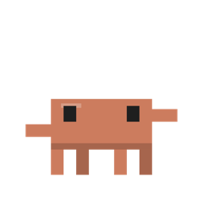
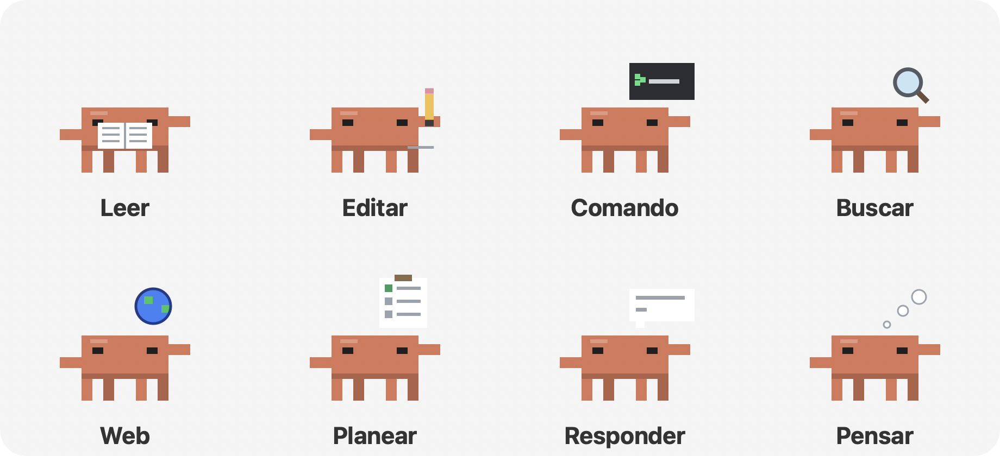
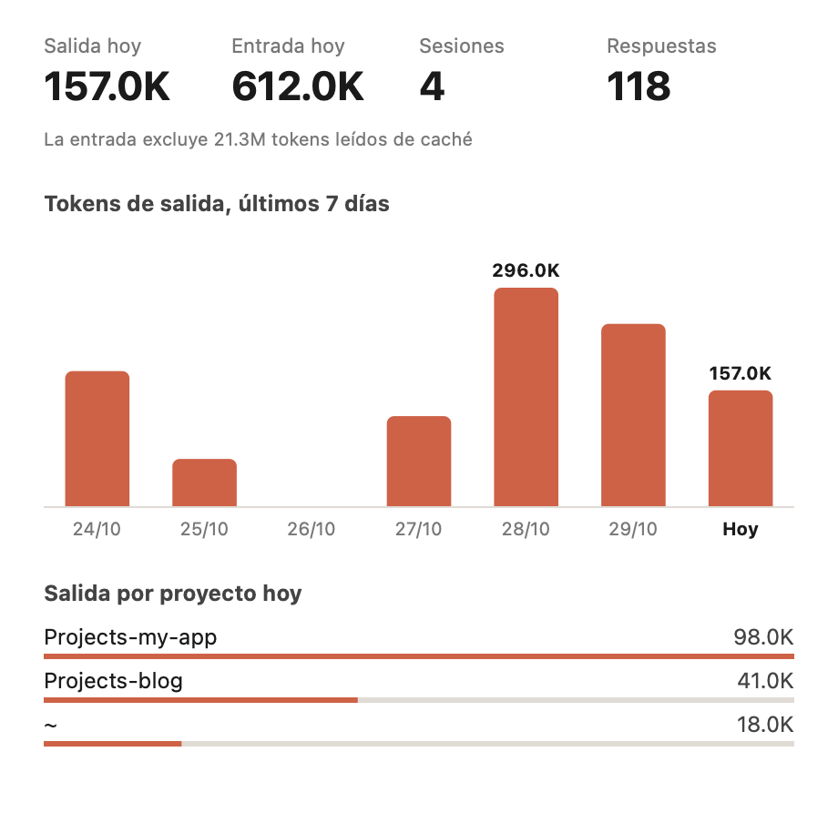
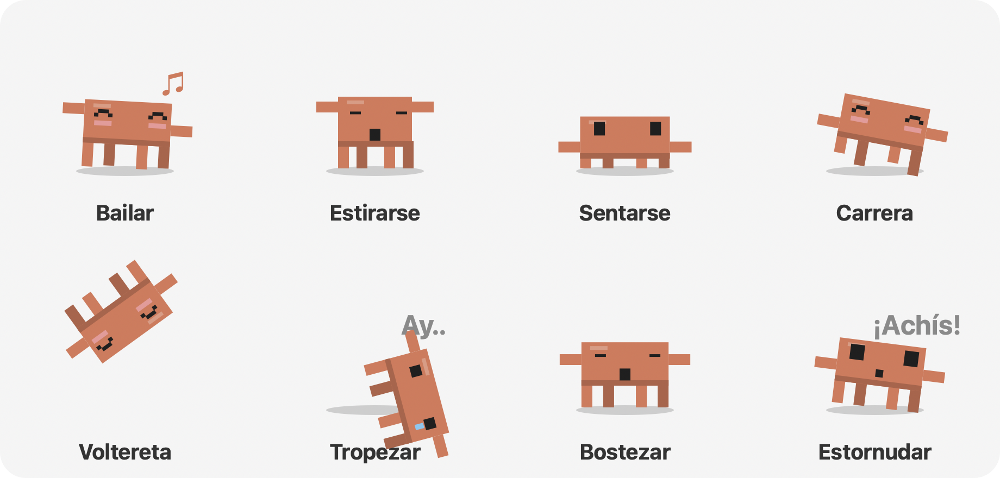

<p align="center">
  
</p>

<h1 align="center">Claude Buddy</h1>

<p align="center">Una mascota de escritorio para macOS que pasea por tu pantalla y te muestra <b>qué están haciendo ahora mismo Claude Code, Codex y Antigravity</b></p>

<p align="center">
  <a href="https://github.com/Junseung0526/claude-buddy/releases/latest"></a>
  <a href="https://github.com/Junseung0526/claude-buddy/releases"></a>
  
  
  <a href="LICENSE"></a>
</p>

<p align="center">
  <a href="https://github.com/Junseung0526/claude-buddy/releases/latest/download/Claude-Buddy-macOS-arm64.zip"><b>⬇ Descargar para macOS</b></a>
</p>

<p align="center"><a href="README.md">한국어</a> · <a href="README.en.md">English</a> · <a href="README.ja.md">日本語</a> · <a href="README.zh-CN.md">简体中文</a> · <b>Español</b></p>


Un personaje en pixel art inspirado en la mascota de Claude camina por la parte inferior de la pantalla y por encima de las ventanas de otras apps. Cuando Claude Code empieza a trabajar, muestra la tarea actual sobre su cabeza, y cuando se ejecutan subagentes aparecen personajes pequeños que trabajan con él. También puedes acariciarlo, lanzarlo, jugar a la pelota, darle bocadillos y usar juntos un temporizador de enfoque. Si le haces una pregunta, responde brevemente a través de la CLI de Claude, Codex o Antigravity en la que ya hayas iniciado sesión. La interfaz está disponible en 한국어, English, 日本語, 简体中文 y Español.

---

## Contenido

1. [Funciones](#funciones)
2. [Requisitos](#requisitos)
3. [Instalar y ejecutar](#instalar-y-ejecutar)
4. [Compilarlo tú mismo](#compilarlo-tú-mismo)
5. [Uso](#uso)
6. [Ajustes](#ajustes)
7. [Preguntar a la IA](#preguntar-a-la-ia)
8. [Cómo funciona](#cómo-funciona)
9. [Estructura del proyecto](#estructura-del-proyecto)
10. [Privacidad y datos](#privacidad-y-datos)
11. [Solución de problemas](#solución-de-problemas)
12. [Limitaciones conocidas](#limitaciones-conocidas)
13. [Créditos](#créditos)

---

## Funciones

### 1. Actividad de los agentes de IA en directo
- Una pequeña etiqueta sobre el personaje muestra qué está haciendo Claude Code.

  | Etiqueta de ejemplo | Significado | Animación del personaje |
  |---|---|---|
  | `Nueva solicitud`, `Pensando` | Mensaje nuevo, razonamiento o procesamiento de resultados de herramientas | Puntos en una nube de pensamiento |
  | `Leyendo · buddy.py (desde la línea 120)` | Leer un archivo | Lee un libro y pasa páginas |
  | `Editando · buddy.py`, `Escribiendo · new.py` | Editar un archivo, crear uno nuevo | Dibuja líneas con un lápiz |
  | `Ejecutando · (descripción del comando)` | Ejecutar un comando de terminal | Cursor parpadeando en una terminal diminuta |
  | `Buscando código · 'pattern'`, `Buscando archivos · *.py` | Buscar código o archivos | Lupa dando vueltas |
  | `Búsqueda web · (consulta)`, `Leyendo web · github.com` | Búsqueda web, leer una página | Globo terráqueo girando |
  | `Planificando` | Actualizar la lista de tareas | Marca una lista de verificación |
  | `Escribiendo respuesta` | Escribir la respuesta | Texto que aparece en un globo de diálogo |
  | `Subagente · (nombre de la tarea)` | Llamar a un subagente | Puntos en una nube de pensamiento |
  | `Requiere atención · Responde la pregunta`, `Requiere atención · Permiso necesario` | Espera tu respuesta o tu permiso | Te saluda con la mano y envía una notificación |
  | `Listo` | La tarea terminó (se muestra 8 segundos) | Da un saltito |

  

  El punto a la izquierda de la etiqueta es naranja mientras trabaja y verde al terminar.

- Mientras trabaja, el personaje teclea en su sitio y muestra una **animación con un accesorio según el tipo de tarea**, como en la tabla. Si un paso dura más de 10 segundos, se añade el tiempo transcurrido a la etiqueta (`· 20 s`, `· 2 min`). Los personajes de Codex y Antigravity hacen lo mismo.
- **Ahorro de batería**: dibuja a 60 fps solo al caminar o saltar, a 20 fps cuando está quieto y a 2 fps cuando está oculto. Si nada cambia en pantalla, no se redibuja.
- **Aviso de "requiere atención"**: cuando Claude Code espera tu respuesta a una pregunta (AskUserQuestion, aprobación del plan), el personaje saluda con la mano, muestra "¡Revisa esto!" y avisa con un sonido y una notificación de macOS. La espera de permisos no se escribe en el registro de la sesión, así que la app la supone cuando una herramienta de edición, escritura o descarga web lleva más de 8 segundos sin resultado. Los comandos de shell (Bash) quedan fuera porque pueden tardar mucho legítimamente.
- **Aviso al terminar tareas largas**: cuando termina una tarea que duró más de un minuto, recibes una notificación de macOS aunque estés mirando otra app.
- **Ventana de uso**: elige **Ver uso…** en el menú para abrir una ventana con los tokens de salida y entrada de hoy, las sesiones y respuestas, un gráfico de barras de los tokens de salida de los últimos 7 días (pasa el ratón sobre una barra para ver el valor exacto) y la salida de hoy por proyecto. Solo suma los campos usage de los registros de sesión y no envía nada a ningún sitio.

  
- **Aparece un personaje pequeño por cada subagente en marcha**, hasta seis. Cada uno muestra su tarea sobre la cabeza y trabaja junto al personaje principal. Cuando el subagente termina, grita "¡Listo!", salta y se va caminando fuera de la pantalla.
- Haz clic en un personaje pequeño para ver en un globo la tarea y el estado actual de ese subagente.
- **También aparecen otros agentes de IA.** Mientras uno trabaja, su propio personaje aparece junto al principal y muestra su tarea, y se va al terminar. No hace falta clave API: la app solo lee los registros de actividad que esas herramientas dejan en tu Mac.

  | Agente | Personaje | Registros que lee | Qué muestra |
  |---|---|---|---|
  | Claude Code | Naranja (principal) | JSONL de sesión en `~/.claude/projects/` | Lectura y edición de archivos, comandos, búsquedas, subagentes y más |
  | Codex (GPT) | Cuerpo verde + anillo blanco | JSONL de sesión en `~/.codex/sessions/` | Nueva solicitud, pensando, ejecutando comandos, editando archivos, escribiendo la respuesta |
  | Antigravity (Gemini) | Cuerpo azul + destello morado | `~/.gemini/antigravity-cli/log/`, `~/.gemini/antigravity/log/` | Nueva solicitud, pasos de herramientas, listo |

### 2. Comportamiento del personaje
- **Animación a 60 fps.** Se inclina hacia delante al caminar, levanta las piernas por turnos y se aplasta y estira al aterrizar. La mirada y la inclinación lo siguen con suavidad.
- **Expresiones** que cambian según la situación: normal, parpadeo, feliz (^ ^ con rubor), sorprendido, dolorido (lágrimas), con sueño, concentrado y dormido.
- **Cosas que hace por su cuenta**: además de caminar, descansar, mirar alrededor, dormitar y saltar sobre otras ventanas, mezcla los movimientos de abajo. De noche bosteza y duerme más, y hace menos carreras y volteretas.

  | Movimiento | Cómo se ve |
  |---|---|
  | Bailar | Levanta los brazos por turnos, se balancea y salen notas musicales |
  | Estirarse | Cierra los ojos, sube los brazos y se estira hacia arriba |
  | Sentarse | Baja el cuerpo para sentarse y parpadea de vez en cuando |
  | Carrera loca | Corre tres veces más rápido de lo normal |
  | Voltereta | Salta y da una vuelta completa en el aire antes de aterrizar |
  | Tropezón | Cae de bruces, dice "Ay.." y se levanta |
  | Bostezo | Abre mucho la boca y levanta un poco los brazos |
  | Estornudo | Toma aire y se sacude hacia delante con "¡Achís!" |

  
- **Camina sobre las ventanas**: usa el borde superior de las ventanas de otras apps como plataformas y a veces se cae por el extremo. No usa las partes tapadas por otras ventanas.
- **Varias pantallas**: se mueve por todas las pantallas conectadas.
- **Siempre visible**: se ve sea cual sea la app en primer plano y en todos los escritorios (Spaces). El fondo es completamente transparente.

### 3. Interacción

| Acción | Respuesta |
|---|---|
| Clic | Acariciarlo (corazón) |
| Doble clic | Acariciarlo (corazón y un saltito) |
| Mantener el cursor encima 2,5 segundos | Acariciarlo |
| Acercar el cursor | Se para, mira el cursor y saluda |
| Arrastrar | Levantarlo (las piernas cuelgan, cara de sorpresa) |
| Arrastrar y soltar | Lanzarlo. Rebota en paredes y suelo, y dice "Ay.." tras un aterrizaje fuerte |
| Clic derecho | Abrir el menú (el personaje se queda quieto mientras está abierto) |

**Menú** (clic derecho o el icono de la barra de menús)

| Opción | Qué hace |
|---|---|
| Preguntar… | Escribe una pregunta y Claude, Gemini o GPT responde brevemente (ver [Preguntar a la IA](#preguntar-a-la-ia)) |
| Ver uso… | Ventana con el uso de tokens de Claude Code de hoy y de los últimos 7 días |
| Dar un bocadillo | Cae una galleta en el cursor y el personaje corre a comérsela. Puedes arrastrar la galleta |
| Jugar a la pelota | Lanza la pelota: la persigue, la trae hacia el cursor y espera el siguiente lanzamiento |
| Seguir el cursor | Sigue al cursor y salta a una ventana si el cursor está encima de ella |
| Temporizador de enfoque (25 min) | Muestra el tiempo restante sobre su cabeza y se concentra contigo; al final sugiere un descanso |
| Descansar 30 min | Duerme durante 30 minutos |
| Ajustes | Ver [Ajustes](#ajustes) |

### 4. Reacciones del día a día
- **Lejos del teclado**: tras 5 minutos sin actividad se duerme, y te recibe con "¡Bienvenido!" al volver.
- **Recordatorio de descanso**: tras 50 minutos de uso sin pausa, te recuerda que te estires.
- **De madrugada**: entre las 0:00 y las 5:00 parece tener sueño y te sugiere dejarlo por hoy, una vez por noche.

### 5. Comodidad
- **Icono en la barra de menús**: las mismas funciones que el menú del clic derecho, más la lista de tareas actual de Claude Code y **Ocultar/Mostrar personaje**.
- **Se oculta en pantalla completa**: si la app en primer plano está en pantalla completa (vídeo, presentación), se oculta automáticamente y vuelve después.
- **Sonidos**: sonidos breves del sistema al hacer clic, comer, atrapar, terminar, etc. Puedes desactivarlos en Ajustes.
- **Sin icono en el Dock**: solo aparece el icono de la barra de menús.

---

## Requisitos

- **macOS** en **Apple Silicon (M1 o posterior)**. La versión publicada es solo arm64. En un Mac Intel, [compílalo tú mismo](#compilarlo-tú-mismo).
- La app publicada incluye Python y todas las dependencias, así que no hay que instalar nada más.
- Para compilarlo necesitas **Python 3.10 o posterior**; `build.sh` instala las dependencias.
  - `pyobjc-framework-Cocoa`: ventanas transparentes siempre visibles, dibujo, barra de menús
  - `pyobjc-framework-Quartz`: posición de las ventanas de otras apps, tiempo de inactividad
  - `anthropic`: (opcional) respuestas de Claude con clave API
  - `certifi`: verificación de certificados HTTPS en la app empaquetada

---

## Instalar y ejecutar

### 1. Descargar

Descarga `Claude-Buddy-macOS-arm64.zip` desde [Releases](https://github.com/Junseung0526/claude-buddy/releases/latest) y descomprímelo.

### 2. Moverlo a Aplicaciones

Arrastra `Claude Buddy.app` a la carpeta Aplicaciones.

### 3. Permitirlo la primera vez

La app no está firmada ni notarizada con un certificado de desarrollador de Apple, así que macOS la bloquea la primera vez. Permítela de una de estas formas.

- **Opción 1 (Ajustes del Sistema)**: abre la app una vez, cierra el aviso y haz clic en **Abrir igualmente** al final de **Ajustes del Sistema → Privacidad y seguridad**.
- **Opción 2 (Terminal)**: quita el atributo de cuarentena de la descarga.

  ```bash
  xattr -dr com.apple.quarantine "/Applications/Claude Buddy.app"
  ```

### 4. Abrir y salir

- Haz doble clic en `Claude Buddy.app`. Aparece el personaje y un icono en la barra de menús. No aparece en el Dock.
- Para salir, haz clic derecho en el personaje o usa el icono de la barra de menús y elige **Salir**.
- Para abrirlo al iniciar sesión, añádelo tú en **Ajustes del Sistema → General → Ítems de inicio** (no se añade por defecto).

---

## Compilarlo tú mismo

Puedes ejecutarlo desde el código fuente o compilar la app tú mismo.

```bash
git clone https://github.com/Junseung0526/claude-buddy.git
cd claude-buddy
./build.sh
```

Qué hace `build.sh`:
1. Crea el entorno virtual `.venv` (prefiere `python3.14`; si no, `python3`)
2. Instala las dependencias de `requirements.txt` y PyInstaller
3. Dibuja el personaje como icono de la app (`.icns`)
4. Compila **`dist/Claude Buddy.app`** con Python incluido mediante PyInstaller (app solo de barra de menús, firma ad hoc)
5. Crea **`dist/Claude-Buddy-macOS-<arquitectura>.zip`** para distribuir

Indica la versión así: `VERSION=1.1.0 ./build.sh`. Para ejecutarlo sin compilar:

```bash
.venv/bin/python buddy.py          # o .venv/bin/python -m claude_buddy
```

---

## Uso

1. Al iniciarse, el personaje aparece en la parte inferior de la pantalla y empieza a caminar.
2. Cuando empiezas a trabajar con Claude Code, Codex o Antigravity, el personaje deja lo que estaba haciendo y muestra el progreso.
3. Para preguntar algo, elige **clic derecho → Preguntar…**, escribe la pregunta y pulsa `Enter`. Pulsa `Esc` para cerrar. La respuesta aparece en un globo y se cierra a los 25 segundos, con un aviso de que la ha generado una IA y puede contener errores.

---

## Ajustes

Cámbialos en **Ajustes** del menú. Los valores se guardan en `~/Library/Application Support/Claude Buddy/settings.json` y se conservan para el siguiente inicio.

| Ajuste | Clave | Opciones | Por defecto |
|---|---|---|---|
| Tamaño | `scale` | Pequeño / Normal / Grande | Normal (`6`) |
| Velocidad | `speed` | Lenta / Normal / Rápida | Normal (`55`) |
| Sonido | `sound` | Sí / No | Sí |
| Notificaciones (atención, tareas largas) | `notify` | Sí / No | Sí |
| Idioma | `lang` | Usar idioma del sistema (`auto`) / 한국어 (`ko`) / English (`en`) / 日本語 (`ja`) / 简体中文 (`zh`) / Español (`es`) | Idioma del sistema (coreano para quien ya usaba la app antes de añadir idiomas) |
| Subir a las ventanas | `windows` | Sí / No | Sí |
| Mostrar trabajo de agentes | `activity` | Sí / No | Sí |
| Modelo de respuesta | `ask_provider` | Claude / Gemini / GPT | Claude (`claude`) |

También puedes editar `settings.json` directamente (se aplica tras reiniciar).

```json
{
 "scale": 6,
 "speed": 55,
 "sound": true,
 "windows": true,
 "activity": true,
 "notify": true,
 "lang": "es",
 "ask_provider": "claude"
}
```

---

## Preguntar a la IA

Esta función es opcional. **Preguntar** busca una forma de responder en este orden.

| Situación | Qué pasa |
|---|---|
| **Has iniciado sesión en la CLI del modelo elegido** (por defecto) | La CLI responde en el idioma elegido en 3 frases como máximo. No hace falta clave API |
| No hay CLI, pero **hay una clave API** | Llama a la API directamente de la misma forma |
| Ninguna de las dos | Te avisa de que necesitas iniciar sesión o añadir una clave |

Las respuestas a través de la CLI cuentan para tu suscripción y tardan 5–10 segundos porque la CLI tiene que arrancar. No se usan herramientas ni se guarda registro de sesión, así que la pregunta no aparece como trabajo de un agente.

| Opción | CLI usada | Inicio de sesión |
|---|---|---|
| Claude | `claude -p` (Haiku) | Sesión de Claude Code |
| Gemini | `agy -p` | Sesión de Antigravity |
| GPT | `codex exec` | Sesión de Codex |

Las CLI se buscan en `PATH`, `~/.local/bin`, `/opt/homebrew/bin` y `/usr/local/bin`.

### Elegir el modelo de respuesta

Elígelo en **Ajustes → Modelo de respuesta**. Los modelos de abajo son los que se llaman con clave API cuando no hay CLI; todos son modelos económicos adecuados para respuestas cortas.

| Opción | Modelo | Obtener una clave |
|---|---|---|
| Claude | `claude-haiku-5-5` | [Anthropic Console](https://console.anthropic.com/) |
| Gemini | `gemini-flash-lite-latest` | [Google AI Studio](https://aistudio.google.com/apikey) |
| GPT | `gpt-5-mini` | [OpenAI Platform](https://platform.openai.com/api-keys) |

### Configurar una clave API (solo sin CLI)

Elige el modelo, luego **Ajustes → Configurar clave API de (modelo)…**, pega la clave y pulsa `Enter`. La clave se oculta mientras escribes.

- Las claves se guardan por modelo en el **llavero de macOS** (servicio `Claude Buddy`), no en el archivo de ajustes. No hace falta reiniciar.
- Usa **Cambiar clave API…** para sustituir una clave y **Borrar clave API** para eliminarla.
- Las claves se buscan primero en las variables de entorno (`ANTHROPIC_API_KEY`, `GEMINI_API_KEY`, `OPENAI_API_KEY`) y después en el llavero.

### Ajustes para gastar poco

- Como máximo 400 tokens por respuesta
- Claude: razonamiento extendido desactivado, effort `low`
- GPT: reasoning effort `minimal`

- Si la solicitud falla (red, autenticación, rechazo, modelo renombrado, etc.) o la respuesta llega vacía, te avisa de que no pudo obtener respuesta.
- El uso de la API puede tener coste según cada proveedor.

---

## Cómo funciona

### Ventanas transparentes siempre visibles
El personaje, los globos, los juguetes y las etiquetas de estado son **`NSWindow` transparentes y sin borde**. Están en `NSStatusWindowLevel` y se unen a todos los Spaces y a las áreas auxiliares de pantalla completa, así que otras apps no pueden taparlos.

> La primera versión usaba tkinter (Tk 9), pero en macOS el fondo transparente salía negro y la ventana se escondía detrás de otras apps, así que se pasó a PyObjC (Cocoa).

### Detectar la actividad de Claude Code
Claude Code escribe sus registros de sesión en archivos JSONL. Buddy **solo lee estos archivos, sin tocar ajustes ni hooks**.

```
~/.claude/projects/<proyecto>/<ID de sesión>.jsonl              ← registro de la sesión principal
~/.claude/projects/<proyecto>/<ID de sesión>/subagents/
    agent-<ID>.jsonl                                            ← registro del subagente
    agent-<ID>.meta.json                                        ← {"description": ..., "finished": true|false}
```

1. Cada segundo elige el archivo de sesión **más reciente** modificado en los últimos 15 minutos.
2. Lee solo las líneas nuevas añadidas al final (tail) y decide la etiqueta actual a partir de los bloques `tool_use`, `tool_result`, de razonamiento y de respuesta.
3. Se considera "trabajando" mientras haya una herramienta esperando su resultado o hayan pasado menos de 25 segundos desde la última entrada.
4. Los subagentes aparecen y terminan según el valor `finished` de `subagents/*.meta.json`.

### Caminar sobre las ventanas
Cada 0,4 segundos lee la posición de las ventanas normales visibles con `CGWindowListCopyWindowInfo` de Quartz. Solo usa como plataformas las **partes de los bordes superiores que no tapan las ventanas de delante**. Se omiten las ventanas maximizadas pegadas a la barra de menús y las muy pequeñas. Esta API no lee los títulos de las ventanas, así que **no hace falta el permiso de grabación de pantalla**.

### Física
Todos los personajes y juguetes comparten la misma gravedad (2200 pt/s²). El impacto al aterrizar decide el rebote, el aplastamiento y la cara de dolor. Para llegar a un objetivo a otra altura, calcula un salto parabólico y salta hacia arriba o hacia abajo.

---

## Estructura del proyecto

```
claude-buddy/
├── buddy.py              # Punto de entrada (común al código fuente y a la compilación con PyInstaller)
├── claude_buddy/         # Paquete principal
│   ├── __main__.py       # main(): inicia la app, opción --icon (python -m claude_buddy)
│   ├── app.py            # Buddy: coordina todo (trabajo por fotograma, comportamiento, globos, Preguntar)
│   ├── config.py         # Rutas, ajustes por defecto, constantes físicas, guardado de ajustes
│   ├── activity.py       # Sigue los registros de Claude Code, Codex y Antigravity → etiquetas de tarea
│   ├── world.py          # Áreas de pantalla, plataformas de ventanas, detección de pantalla completa
│   ├── critter.py        # Dibujo, física y movimientos del personaje (principal y mini)
│   ├── toy.py            # Bocadillo y pelota
│   ├── widgets.py        # Globos, botones, chip de estado, ventana de uso
│   ├── menu.py           # Estructura y acciones del menú
│   ├── usage.py          # Uso de tokens de Claude Code (usage de los registros sumado por día y proyecto)
│   ├── i18n.py           # Traducciones de la interfaz (한국어, English, 日本語, 简体中文, Español)
│   ├── llm.py            # Modelos de respuesta de Preguntar (Claude, Gemini, GPT) y claves API (llavero)
│   ├── gfx.py            # Colores, utilidades de dibujo, ventanas transparentes, etiquetas, sonidos
│   └── icon.py           # Icono de la app y de la barra de menús
├── build.sh              # Compila la app independiente (.app) y el zip de publicación con PyInstaller
├── requirements.txt      # Dependencias
├── docs/                 # Imágenes del README (una carpeta por idioma)
├── LICENSE               # MIT
├── CHANGELOG.md          # Historial de cambios
├── THIRD_PARTY_NOTICES.md # Licencias de código abierto de los componentes incluidos en la app
├── README.md             # Coreano (README.en.md · README.ja.md · README.zh-CN.md · README.es.md)
└── .gitignore
```

Las dependencias entre módulos van en un solo sentido (sin ciclos).

```
__main__ → app → menu, critter, toy, widgets, world, activity, usage, llm, icon → i18n, gfx, config
```

- Los juegos o juguetes nuevos van en `toy.py`, `menu.py` (opción del menú) y `app.py` (reacción).
- El aspecto y las caras del personaje se cambian en `draw_critter` de `critter.py`, y su comportamiento en `brain` de `app.py`.
- Los ajustes nuevos van en `DEFAULTS` de `config.py` y en el menú (`menu.py`).
- Envuelve los textos de la interfaz en `t("texto en coreano")` y añade las traducciones al inglés, japonés, chino y español en `TR` de `i18n.py`. `python -m claude_buddy.i18n` comprueba si faltan traducciones o si no coinciden los marcadores.

Archivos creados al ejecutar (no están en el repositorio):

| Archivo | Contenido |
|---|---|
| `~/Library/Application Support/Claude Buddy/settings.json` | Tus ajustes |
| `.venv/` | Entorno virtual (si lo compilas tú) |
| `build/`, `dist/` | Resultado de PyInstaller |

---

## Privacidad y datos

- Todo se procesa **solo en tu Mac**.
- Los registros de sesión de Claude Code **solo se leen**; no se envían ni se guardan en ningún sitio. En pantalla se muestran poco más que nombres de herramientas y de archivos.
- La única comunicación hacia fuera es la pregunta que escribes en Preguntar, enviada al proveedor elegido (Anthropic, Google u OpenAI) a través de su CLI o de tu clave API.
- No hay cuentas ni registro, ni estadísticas de uso, anuncios o código de seguimiento.
- Los únicos datos que quedan son el archivo de ajustes y las claves API del llavero. Para borrarlos, elimina la carpeta `~/Library/Application Support/Claude Buddy` y usa **Borrar clave API** en el menú (o borra los elementos `Claude Buddy` en Acceso a Llaveros).
- Al compartir pantalla pueden verse las etiquetas de tarea (nombres de archivo, etc.). Si hace falta, usa el icono de la barra de menús → **Ocultar personaje**.

---

## Solución de problemas

| Problema | Solución |
|---|---|
| No se abre por el aviso de "desarrollador no identificado" | Ver [Permitirlo la primera vez](#3-permitirlo-la-primera-vez). |
| No pasa nada al hacer doble clic en la app | Ejecuta `"/Applications/Claude Buddy.app/Contents/MacOS/Claude Buddy"` en Terminal y mira el mensaje de error. |
| No se muestra el trabajo de los agentes | Comprueba que "Mostrar trabajo de agentes" está activado en Ajustes y que hubo una sesión activa en los últimos 15 minutos. |
| La IA no responde en Preguntar | Comprueba que has iniciado sesión en la CLI del modelo elegido (`claude`, `codex`, `agy`) o que la clave API es correcta. Ver [Preguntar a la IA](#preguntar-a-la-ia). |
| No se ve el personaje | Puede haber una app en pantalla completa delante, o puede estar oculto desde el icono de la barra de menús. |
| Sube a las ventanas demasiado a menudo | Desactiva "Subir a las ventanas" en Ajustes. |

---

## Limitaciones conocidas

- Solo para macOS; la app publicada es solo para Apple Silicon.
- No está notarizada por Apple, así que hay que permitir el primer arranque.
- No sabe si estás compartiendo pantalla. Ocúltalo tú si hace falta.
- Cada agente sigue solo **su sesión activa más reciente**.
- Gemini CLI aún no es compatible. Antigravity solo muestra lo que contienen sus registros, así que muestra números de paso en lugar de qué herramienta se está usando.
- Si cambia el formato de los registros de sesión, las etiquetas de tarea pueden no ser exactas.
- Preguntar no recuerda las preguntas anteriores: responde una pregunta cada vez.

---

## Créditos

- Personaje: pixel art hecho por fans e inspirado en la mascota Claude de Anthropic. Sin relación oficial con Anthropic.
- "Claude" es una marca de Anthropic. Codex es un producto de OpenAI, y Antigravity y Gemini son productos de Google. Este es un proyecto no oficial hecho por fans, sin aprobación ni patrocinio de ninguna de ellas.
- Los componentes de código abierto incluidos en la app y sus licencias están en [THIRD_PARTY_NOTICES.md](THIRD_PARTY_NOTICES.md) (también dentro de la app, en `Contents/Resources`).
- Este proyecto se publica bajo la [licencia MIT](LICENSE).
