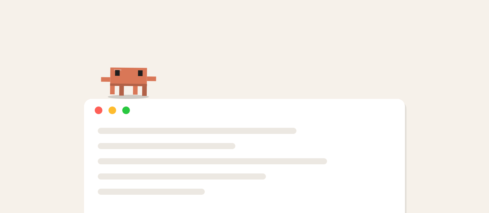
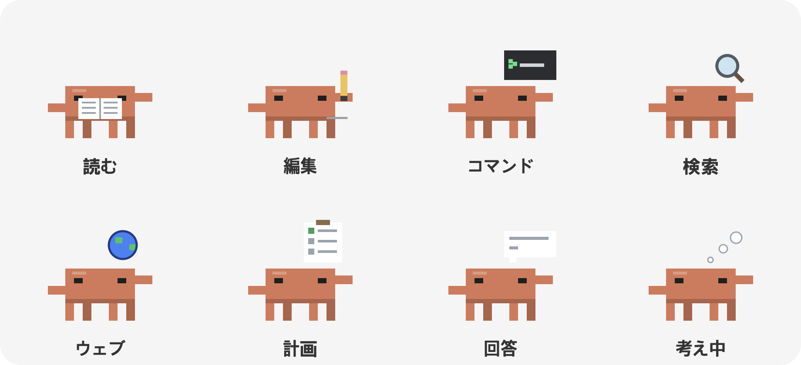
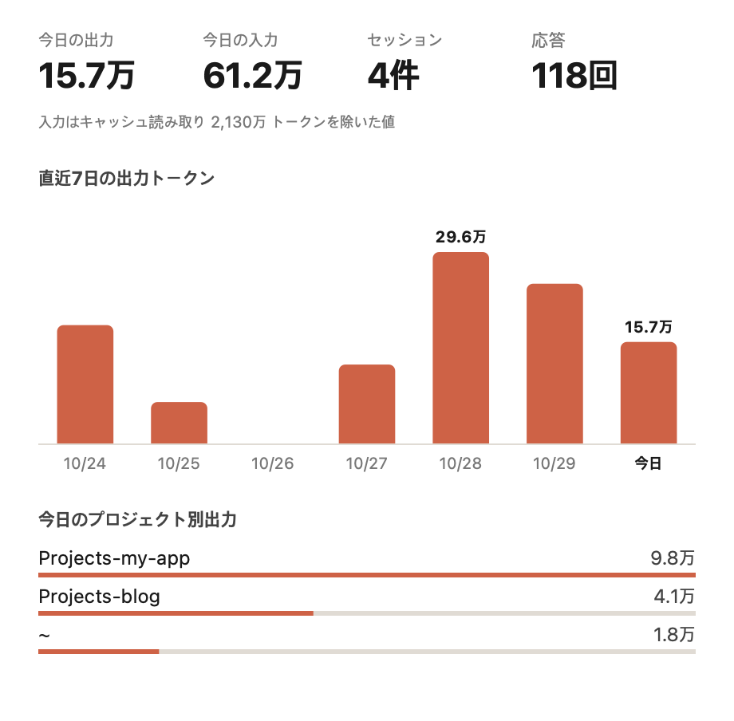
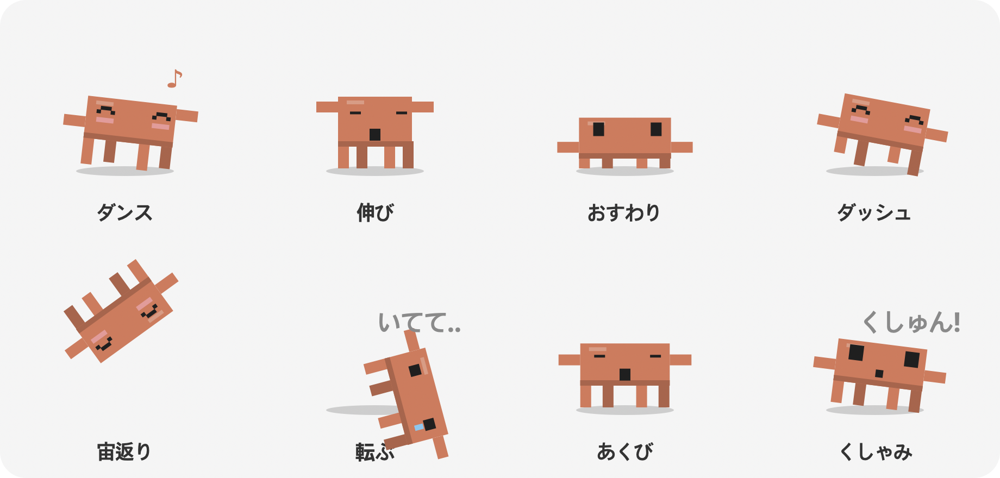

<p align="center">
  
</p>

<h1 align="center">Claude Buddy</h1>

<p align="center">画面の中を歩き回りながら、<b>Claude Code・Codex・Antigravity がいま何をしているか</b>を見せてくれる macOS デスクトップペット</p>

<p align="center">
  <a href="https://github.com/Junseung0526/claude-buddy/releases/latest"></a>
  <a href="https://github.com/Junseung0526/claude-buddy/releases"></a>
  
  
  <a href="LICENSE"></a>
</p>

<p align="center">
  <a href="https://github.com/Junseung0526/claude-buddy/releases/latest/download/Claude-Buddy-macOS-arm64.zip"><b>⬇ macOS 版をダウンロード</b></a>
</p>

<p align="center"><a href="README.md">English</a> · <a href="README.ko.md">한국어</a> · <b>日本語</b> · <a href="README.zh-CN.md">简体中文</a> · <a href="README.es.md">Español</a></p>

<p align="center"></p>


Claude のマスコットをモチーフにしたピクセルアートのキャラクターが、画面の下端や他のアプリのウィンドウの上を歩き回ります。Claude Code が作業を始めると、いまの作業を頭の上に表示し、サブエージェントが動くと小さなキャラクターが出てきて一緒に働きます。なでたり、投げたり、ボール遊びやおやつ、集中タイマーも一緒にできます。質問すると、ログイン済みの Claude・Codex・Antigravity CLI を通して短く答えてくれます。画面の表示は 한국어・English・日本語・简体中文・Español に対応しています。

---

## 目次

1. [機能](#機能)
2. [動作環境](#動作環境)
3. [インストールと起動](#インストールと起動)
4. [自分でビルドする](#自分でビルドする)
5. [使い方](#使い方)
6. [設定](#設定)
7. [AI に質問する](#ai-に質問する)
8. [仕組み](#仕組み)
9. [プロジェクト構成](#プロジェクト構成)
10. [プライバシーとデータ](#プライバシーとデータ)
11. [トラブルシューティング](#トラブルシューティング)
12. [既知の制限](#既知の制限)
13. [クレジット](#クレジット)

---

## 機能

### 1. AI エージェントの作業をリアルタイム表示
- キャラクターの頭上の小さなラベルに、Claude Code がいま何をしているかを表示します。

  | ラベルの例 | 意味 | キャラクターのアニメーション |
  |---|---|---|
  | `新しいリクエスト`、`考え中` | 新しいメッセージ、推論、ツール結果の処理 | 考え中の雲の点 |
  | `読み込み中 · buddy.py (120行目から)` | ファイルを読む | 本を読みながらページをめくる |
  | `編集中 · buddy.py`、`作成中 · new.py` | ファイルの編集、新規作成 | 鉛筆で線を書く |
  | `実行中 · (コマンドの説明)` | ターミナルコマンドの実行 | 小さなターミナルでカーソルが点滅 |
  | `コード検索 · 'pattern'`、`ファイル検索中 · *.py` | コードやファイルの検索 | 虫めがねがぐるぐる回る |
  | `ウェブ検索 · (検索語)`、`ウェブ閲覧中 · github.com` | Web 検索、ページを読む | 地球儀が回る |
  | `計画中` | ToDo リストの更新 | チェックリストにチェック |
  | `回答作成中` | 返答を書く | 吹き出しに文字が出てくる |
  | `サブエージェント · (作業名)` | サブエージェントの呼び出し | 考え中の雲の点 |
  | `確認が必要 · 質問に答えてください`、`確認が必要 · 権限の確認` | あなたの回答や許可を待っている | 手を振って通知を送る |
  | `完了` | 作業が終わった(8 秒間表示) | ぴょんと跳ねる |

  

  ラベル左の点は作業中はオレンジ、完了するとグリーンになります。

- 作業中のキャラクターはその場でタイピングしながら、上の表のように**作業の種類ごとの小道具アニメーション**を見せます。1 つの作業が 10 秒以上続くと、経過時間がラベルに付きます(`· 20秒`、`· 2分`)。Codex・Antigravity のキャラクターも同じです。
- **省電力**: 歩いたりジャンプしたりするときだけ 60fps、止まっているときは 20fps、隠れているときは 2fps で描画し、画面が変わらなければ描き直しません。
- **「確認が必要」アラート**: Claude Code があなたの回答(AskUserQuestion、プランの承認)を待っていると、キャラクターが手を振って「確認して!」と表示し、効果音と macOS 通知で知らせます。許可待ちはセッションログに残らないため、編集・作成・Web 取得のツールが 8 秒以上結果を返さないと許可待ちとみなします。シェルコマンド(Bash)は長くかかることがあるので対象外です。
- **長い作業の完了通知**: 1 分以上かかった作業が終わると、別のアプリを見ていても macOS 通知でお知らせします。
- **使用量ウィンドウ**: メニューの **使用量を見る…** を選ぶと、今日の出力・入力トークン、セッション数、返答数、直近 7 日間の出力トークンの棒グラフ(棒にマウスを乗せると正確な値)、プロジェクト別の今日の出力をまとめたウィンドウが開きます。セッションログの usage を合計するだけで、どこにも送信しません。

  
- **サブエージェントが動くたびに小さなキャラクター**が出てきます(最大 6 体)。それぞれ自分の作業を頭上に表示し、メインキャラクターの横で働きます。サブエージェントが終わると「完了!」と叫んでジャンプし、画面の外へ歩いていきます。
- 小さなキャラクターをクリックすると、そのサブエージェントの作業と現在の状態を吹き出しで見られます。
- **他の AI エージェントも表示されます。** 作業中はメインキャラクターの横にそれぞれのキャラクターが現れて作業を見せ、終わると去っていきます。API キーは不要で、各ツールが Mac に残す作業ログを読むだけです。

  | エージェント | キャラクター | 読むログ | 表示する内容 |
  |---|---|---|---|
  | Claude Code | オレンジ(メイン) | `~/.claude/projects/` のセッション JSONL | ファイルの読み込み・編集、コマンド、検索、サブエージェントなど |
  | Codex (GPT) | 緑の体 + 白いリング | `~/.codex/sessions/` のセッション JSONL | 新しいリクエスト、考え中、コマンド実行、ファイル編集、回答作成 |
  | Antigravity (Gemini) | 青い体 + 紫のきらめき | `~/.gemini/antigravity-cli/log/`、`~/.gemini/antigravity/log/` | 新しいリクエスト、ツールのステップ、完了 |

### 2. キャラクターの動き
- **60fps のアニメーション**: 歩くときは前に傾いて足を交互に上げ、着地すると押しつぶされてから伸びます。視線や傾きもなめらかについてきます。
- **表情**が状況に合わせて変わります: ふつう、まばたき、うれしい(^ ^ と頬の赤み)、びっくり、痛い(涙)、眠い、集中、睡眠。
- **自分でやること**: 歩く・休む・見回す・うたた寝・ウィンドウに飛び乗る以外に、次の動きを織り交ぜます。夜はあくびや睡眠が増え、ダッシュや宙返りは減ります。

  | 動き | 様子 |
  |---|---|
  | ダンス | 腕を交互に上げて揺れ、音符が出る |
  | 伸び | 目を閉じて腕を上げ、体をぐっと伸ばす |
  | おすわり | 体を低くして座り、ときどきまばたき |
  | ダッシュ | いつもの 3 倍の速さで走る |
  | 宙返り | ジャンプして空中で一回転して着地 |
  | すってん | 前にばったり倒れて「いてて..」と言ってから起き上がる |
  | あくび | 口を大きく開けて腕を少し上げる |
  | くしゃみ | 息を吸ってから「くしゅん!」と前にのけぞる |

  
- **ウィンドウの上を歩く**: 他のアプリのウィンドウの上端を足場にして歩き、端から落ちることもあります。他のウィンドウに隠れた部分は使いません。
- **マルチディスプレイ**: つないでいるすべての画面を行き来します。
- **常に最前面**: どのアプリが前面にあっても、どのデスクトップ(Space)でも見えます。背景は完全に透明です。

### 3. 操作

| 操作 | 反応 |
|---|---|
| クリック | なでる(ハート) |
| ダブルクリック | なでる(ハート + ぴょん) |
| 2.5 秒ホバー | なでる |
| カーソルを近づける | 立ち止まってカーソルを見て手を振る |
| ドラッグ | 持ち上げる(足がぶらぶら、びっくり顔) |
| ドラッグして離す | 投げる。壁や床で跳ね返り、強く落ちると「いてて..」 |
| 右クリック | メニューを開く(開いている間はキャラクターが止まる) |

**メニュー**(右クリックまたはメニューバーのアイコン)

| メニュー | 内容 |
|---|---|
| 質問する… | 質問を入力すると Claude・Gemini・GPT が短く答える([AI に質問する](#ai-に質問する)を参照) |
| 使用量を見る… | 今日と直近 7 日間の Claude Code トークン使用量のウィンドウ |
| おやつをあげる | カーソルの位置にクッキーが落ち、キャラクターが走ってきて食べる。クッキーはドラッグで動かせる |
| ボール遊び | ボールを投げると追いかけてカーソルのほうへ持ってきて、次を待つ |
| カーソルについてくる | カーソルについていき、カーソルがウィンドウの上ならジャンプして乗る |
| 集中タイマー (25分) | 残り時間を頭上に表示して一緒に集中し、終わったら休憩をすすめる |
| 30分休む | 30 分間眠る |
| 設定 | [設定](#設定)を参照 |

### 4. 日常のリアクション
- **離席**: 5 分間入力がないと眠り、戻ってくると「おかえり!」と迎えます。
- **休憩のすすめ**: 休まず 50 分使い続けると、ストレッチをすすめます。
- **深夜**: 0 時〜5 時は眠そうにして、そろそろ終わりにしようと一晩に一度すすめます。

### 5. 便利機能
- **メニューバーアイコン**: 右クリックメニューと同じ機能に加えて、Claude Code の現在の ToDo リストと **キャラクターを隠す/表示** があります。
- **フルスクリーン中は隠れる**: 前面のアプリがフルスクリーン(動画、プレゼン)なら自動で隠れ、終わると戻ってきます。
- **効果音**: クリック・食べる・キャッチ・完了などで短いシステムサウンドが鳴ります。設定でオフにできます。
- **Dock アイコンなし**: メニューバーのアイコンだけが表示されます。

---

## 動作環境

- **macOS**、**Apple Silicon(M1 以降)**。配布ビルドは arm64 専用です。Intel Mac では[自分でビルド](#自分でビルドする)してください。
- 配布アプリには Python と依存パッケージがすべて含まれているので、別途インストールは不要です。
- 自分でビルドするには **Python 3.10 以上**が必要で、依存パッケージは `build.sh` がインストールします。
  - `pyobjc-framework-Cocoa`: 透明な最前面ウィンドウ、描画、メニューバー
  - `pyobjc-framework-Quartz`: 他のアプリのウィンドウ位置、入力の待機時間
  - `anthropic`: (任意)API キーでの Claude の回答
  - `certifi`: 同梱アプリでの HTTPS 証明書の検証

---

## インストールと起動

### 1. ダウンロード

[Releases](https://github.com/Junseung0526/claude-buddy/releases/latest) から `Claude-Buddy-macOS-arm64.zip` をダウンロードして展開します。

### 2. アプリケーションフォルダへ移動

`Claude Buddy.app` をアプリケーションフォルダへドラッグします。

### 3. 初回の許可

Apple の開発者証明書で署名・公証されていないため、初回は macOS にブロックされます。次のどちらかで許可してください。

- **方法 1(システム設定)**: 一度アプリを開いて警告を閉じ、**システム設定 → プライバシーとセキュリティ** の下にある **このまま開く** をクリックします。
- **方法 2(ターミナル)**: ダウンロード時の隔離属性を外します。

  ```bash
  xattr -dr com.apple.quarantine "/Applications/Claude Buddy.app"
  ```

### 4. 起動と終了

- `Claude Buddy.app` をダブルクリックすると、キャラクターが現れてメニューバーにアイコンが出ます。Dock には表示されません。
- 終了するには、キャラクターを右クリックするかメニューバーのアイコンから **終了** を選びます。
- ログイン時に自動起動したい場合は、**システム設定 → 一般 → ログイン項目** に自分で追加してください(デフォルトでは追加されません)。

---

## 自分でビルドする

ソースからそのまま実行することも、アプリを自分でビルドすることもできます。

```bash
git clone https://github.com/Junseung0526/claude-buddy.git
cd claude-buddy
./build.sh
```

`build.sh` がすること:
1. 仮想環境 `.venv` を作成(`python3.14` を優先、なければ `python3`)
2. `requirements.txt` の依存パッケージと PyInstaller をインストール
3. キャラクターを描いてアプリアイコン(`.icns`)を作成
4. PyInstaller で Python 同梱の **`dist/Claude Buddy.app`** をビルド(メニューバー専用アプリ、ad-hoc 署名)
5. 配布用の **`dist/Claude-Buddy-macOS-<アーキテクチャ>.zip`** を作成

バージョンは `VERSION=1.1.0 ./build.sh` のように指定します。ビルドせずに実行するには:

```bash
.venv/bin/python buddy.py          # または .venv/bin/python -m claude_buddy
```

バージョンタグ(`v1.6.0` など)をプッシュすると、GitHub Actions がアプリをビルドし、`CHANGELOG.md` の該当バージョンの内容でリリースを公開します。

---

## 使い方

1. 起動するとキャラクターが画面の下に現れて歩き始めます。
2. Claude Code・Codex・Antigravity で作業を始めると、キャラクターはしていたことをやめて進み具合を見せます。
3. 聞きたいことがあれば **右クリック → 質問する…** に入力して `Enter` を押します。`Esc` で閉じます。答えは吹き出しで表示され、25 秒後に自動で閉じます。AI が生成した回答のため誤りを含む場合がある、という注意書きが一緒に付きます。

---

## 設定

メニューの **設定** で変更します。値は `~/Library/Application Support/Claude Buddy/settings.json` に保存され、次回起動時も保たれます。

| 設定 | キー | 選択肢 | デフォルト |
|---|---|---|---|
| サイズ | `scale` | 小 / 中 / 大 | 中(`6`) |
| 歩く速さ | `speed` | ゆっくり / ふつう / 速い | ふつう(`55`) |
| 効果音 | `sound` | オン / オフ | オン |
| 通知(確認が必要・長い作業の完了) | `notify` | オン / オフ | オン |
| 言語 | `lang` | システムに合わせる(`auto`) / 한국어(`ko`) / English(`en`) / 日本語(`ja`) / 简体中文(`zh`) / Español(`es`) | システムの言語(言語機能の追加前から使っている人は韓国語) |
| ウィンドウに登る | `windows` | オン / オフ | オン |
| エージェントの作業を表示 | `activity` | オン / オフ | オン |
| 回答モデル | `ask_provider` | Claude / Gemini / GPT | Claude(`claude`) |

`settings.json` を直接編集することもできます(再起動後に反映)。

```json
{
 "scale": 6,
 "speed": 55,
 "sound": true,
 "windows": true,
 "activity": true,
 "notify": true,
 "lang": "ja",
 "ask_provider": "claude"
}
```

---

## AI に質問する

この機能は任意です。**質問する** は次の順に答える方法を探します。

| 状況 | 動作 |
|---|---|
| **選んだモデルの CLI にログイン済み**(デフォルト) | CLI が選んだ言語で 3 文以内で答える。API キー不要 |
| CLI はないが **API キーが設定済み** | 同じ方法で API を直接呼び出す |
| どちらもない | ログインかキーが必要だと案内する |

CLI での回答はサブスクリプションの使用量に含まれ、CLI を起動するため 5〜10 秒かかります。ツールは使わず、セッションログも残さないので、質問がエージェントの作業として表示されることはありません。

| 選択 | 使う CLI | ログイン |
|---|---|---|
| Claude | `claude -p`(Haiku) | Claude Code のログイン |
| Gemini | `agy -p` | Antigravity のログイン |
| GPT | `codex exec` | Codex のログイン |

CLI は `PATH`、`~/.local/bin`、`/opt/homebrew/bin`、`/usr/local/bin` から探します。

### 回答モデルの選択

**設定 → 回答モデル** で選びます。下のモデルは CLI がないときに API キーで呼び出すもので、どれも短い回答向けの低コストモデルです。

| 選択 | モデル | キーの取得 |
|---|---|---|
| Claude | `claude-haiku-5-5` | [Anthropic Console](https://console.anthropic.com/) |
| Gemini | `gemini-flash-lite-latest` | [Google AI Studio](https://aistudio.google.com/apikey) |
| GPT | `gpt-5-mini` | [OpenAI Platform](https://platform.openai.com/api-keys) |

### API キーの設定(CLI がない場合のみ)

モデルを選んでから **設定 → (モデル) API キーを設定…** を選び、キーを貼り付けて `Enter` を押します。入力中のキーは隠されます。

- キーは設定ファイルではなく **macOS キーチェーン**(サービス名 `Claude Buddy`)にモデルごとに保存されます。再起動は不要です。
- **API キーを変更…** で差し替え、**API キーを削除** で消せます。
- キーは環境変数(`ANTHROPIC_API_KEY`、`GEMINI_API_KEY`、`OPENAI_API_KEY`)を先に、次にキーチェーンを探します。

### コストを抑える設定

- 1 回の回答は最大 400 トークン
- Claude: 拡張思考オフ、effort `low`
- GPT: reasoning effort `minimal`

- リクエストが失敗した場合(ネットワーク、認証、拒否、モデル名の変更など)や返答が空の場合は、答えを受け取れなかったと案内します。
- API の利用には各社の料金がかかる場合があります。

---

## 仕組み

### 透明な最前面ウィンドウ
キャラクター、吹き出し、おもちゃ、状態ラベルはすべて **枠のない透明な `NSWindow`** です。`NSStatusWindowLevel` に置き、すべての Space とフルスクリーンの補助領域に参加させるので、他のアプリに隠れません。

> 最初のバージョンは tkinter(Tk 9)でしたが、macOS では透明な背景が黒くなり、他のアプリの後ろに隠れてしまうため PyObjC(Cocoa)に移行しました。

### Claude Code の作業を検知する
Claude Code はセッションログを JSONL ファイルに書きます。Buddy は **設定やフックに触れず、このファイルを読むだけ**です。

```
~/.claude/projects/<プロジェクト>/<セッション ID>.jsonl              ← メインセッションのログ
~/.claude/projects/<プロジェクト>/<セッション ID>/subagents/
    agent-<ID>.jsonl                                               ← サブエージェントのログ
    agent-<ID>.meta.json                                           ← {"description": ..., "finished": true|false}
```

1. 1 秒ごとに、直近 15 分以内に変更されたセッションファイルの中で**最新のもの**を選びます。
2. 末尾に新しく追加された行だけを読み(tail)、`tool_use`、`tool_result`、思考、回答ブロックから現在のラベルを決めます。
3. 結果を待っているツールがあるか、最後の記録から 25 秒以内なら「作業中」とみなします。
4. サブエージェントは `subagents/*.meta.json` の `finished` の値に従って登場・終了します。

### ウィンドウの上を歩く
0.4 秒ごとに Quartz の `CGWindowListCopyWindowInfo` で表示中の通常ウィンドウの位置を読みます。上端のうち**手前のウィンドウに隠れていない部分**だけを足場にします。メニューバーに接する最大化ウィンドウやとても小さいウィンドウは除外します。この API はウィンドウのタイトルを読まないので、**画面収録の権限は不要**です。

### 物理
キャラクターとおもちゃはすべて同じ重力(2200 pt/s²)を使います。着地の衝撃で跳ね返り、つぶれ具合、痛い顔が決まります。高さの違う目標へ行くときは放物線のジャンプを計算して飛び上がったり降りたりします。

---

## プロジェクト構成

```
claude-buddy/
├── buddy.py              # エントリポイント(ソース実行と PyInstaller ビルドで共通)
├── claude_buddy/         # 本体パッケージ
│   ├── __main__.py       # main(): アプリの起動、--icon オプション(python -m claude_buddy)
│   ├── app.py            # Buddy: 全体の調整(フレームごとの処理、行動、吹き出し、質問)
│   ├── config.py         # パス、デフォルト設定、物理定数、設定の保存
│   ├── activity.py       # Claude Code・Codex・Antigravity のログを追跡 → 作業ラベル
│   ├── world.py          # 画面領域、ウィンドウの足場、フルスクリーン検知
│   ├── critter.py        # キャラクターの描画・物理・動き(メインとミニ)
│   ├── toy.py            # おやつとボール
│   ├── widgets.py        # 吹き出し、ボタン、状態チップ、使用量ウィンドウ
│   ├── menu.py           # メニューの構成と動作
│   ├── usage.py          # Claude Code のトークン使用量(セッションログの usage を日・プロジェクト別に集計)
│   ├── i18n.py           # 画面の翻訳(한국어・English・日本語・简体中文・Español)
│   ├── llm.py            # 質問の回答モデル(Claude・Gemini・GPT)と API キー(キーチェーン)
│   ├── gfx.py            # 色、描画ヘルパー、透明ウィンドウ、ラベル、効果音
│   └── icon.py           # アプリとメニューバーのアイコン
├── build.sh              # PyInstaller で単体アプリ(.app)と配布用 zip を作成
├── requirements.txt      # 依存パッケージ
├── docs/                 # README の画像(言語ごとのフォルダ)
├── LICENSE               # MIT
├── CHANGELOG.md          # 変更履歴
├── THIRD_PARTY_NOTICES.md # アプリに同梱するオープンソースのライセンス表示
├── README.md             # 英語 (README.ko.md · README.ja.md · README.zh-CN.md · README.es.md)
└── .gitignore
```

モジュールの依存は一方向です(循環なし)。

```
__main__ → app → menu, critter, toy, widgets, world, activity, usage, llm, icon → i18n, gfx, config
```

- 新しい遊びやおもちゃは `toy.py`、`menu.py`(メニュー項目)、`app.py`(反応)に追加します。
- キャラクターの見た目と表情は `critter.py` の `draw_critter`、行動は `app.py` の `brain` で変えます。
- 新しい設定は `config.py` の `DEFAULTS` とメニュー(`menu.py`)に追加します。
- 画面の文言は `t("韓国語の文")` で囲み、`i18n.py` の `TR` に英語・日本語・中国語・スペイン語の訳を追加します。`python -m claude_buddy.i18n` で訳の抜けやプレースホルダーの不一致を確認できます。

実行中に作られるファイル(リポジトリには含まれません):

| ファイル | 内容 |
|---|---|
| `~/Library/Application Support/Claude Buddy/settings.json` | ユーザー設定 |
| `.venv/` | 仮想環境(自分でビルドする場合) |
| `build/`、`dist/` | PyInstaller の成果物 |

---

## プライバシーとデータ

- すべての処理は**あなたの Mac の中だけ**で行われます。
- Claude Code のセッションログは**読むだけ**で、どこにも送信・保存しません。画面にはツール名とファイル名程度しか表示しません。
- 外部への通信は、質問するに入力した質問を選んだ会社(Anthropic・Google・OpenAI)へ CLI または API キーで送るリクエストだけです。
- アカウントや会員登録はなく、利用統計・広告・トラッキングのコードもありません。
- 残るデータは設定ファイルとキーチェーンの API キーだけです。消すには `~/Library/Application Support/Claude Buddy` フォルダを削除し、メニューの **API キーを削除**(またはキーチェーンアクセスで `Claude Buddy` の項目を削除)を使ってください。
- 画面共有中は作業ラベル(ファイル名など)が見えることがあるので、必要ならメニューバーのアイコン → **キャラクターを隠す** を使ってください。

---

## トラブルシューティング

| 問題 | 解決方法 |
|---|---|
| 「開発元を確認できない」警告で開けない | [初回の許可](#3-初回の許可)を参照してください。 |
| アプリをダブルクリックしても何も起きない | ターミナルで `"/Applications/Claude Buddy.app/Contents/MacOS/Claude Buddy"` を実行してエラーメッセージを確認してください。 |
| エージェントの作業が表示されない | 設定で「エージェントの作業を表示」がオンか、直近 15 分以内に動いたセッションがあるか確認してください。 |
| 質問しても AI が答えない | 選んだモデルの CLI(`claude`、`codex`、`agy`)にログインしているか、API キーが正しいか確認してください。[AI に質問する](#ai-に質問する)を参照。 |
| キャラクターが見えない | フルスクリーンのアプリが前面にあるか、メニューバーのアイコンで隠していないか確認してください。 |
| ウィンドウに登りすぎる | 設定で「ウィンドウに登る」をオフにしてください。 |

---

## 既知の制限

- macOS 専用で、配布アプリは Apple Silicon 専用です。
- Apple の公証を受けていないため、初回起動時に許可が必要です。
- 画面共有中かどうかは検知できません。必要なら自分で隠してください。
- 各エージェントは**最後に動いたセッション 1 つ**だけを追跡します。
- Gemini CLI はまだ対応していません。Antigravity はログに残る情報しか表示できないため、どのツールを使っているかではなくステップ番号を表示します。
- セッションログの形式が変わると、作業ラベルが不正確になることがあります。
- 質問するは前の会話を覚えておらず、一度に 1 つの質問にだけ答えます。

---

## クレジット

- キャラクター: Anthropic の Claude マスコットに着想を得たファンメイドのピクセルアートで、Anthropic とは公式の関係はありません。
- 「Claude」は Anthropic の商標です。Codex は OpenAI、Antigravity・Gemini は Google の製品です。本プロジェクトは非公式のファンプロジェクトで、いずれの会社の承認や後援も受けていません。
- アプリに同梱しているオープンソースのコンポーネントとライセンスは [THIRD_PARTY_NOTICES.md](THIRD_PARTY_NOTICES.md) にあります(アプリ内の `Contents/Resources` にも含まれます)。
- このプロジェクトは [MIT ライセンス](LICENSE) で公開しています。
