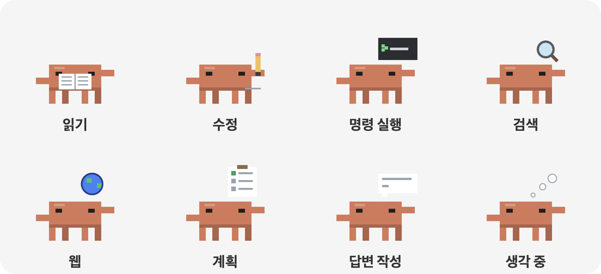

# Claude Buddy

> 화면 위를 돌아다니며 **Claude Code가 지금 하고 있는 작업**을 실시간으로 보여주는 macOS 데스크톱 펫
> (선택 모듈: **AWS 자격증 시험 팁**)


Claude 마스코트를 픽셀아트로 그린 캐릭터가 화면 아래와 다른 앱 창 위를 걸어 다닙니다. Claude Code가 일을 시작하면 머리 위에 현재 작업을 띄워 주고, 서브에이전트가 실행되면 작은 캐릭터들이 튀어나와 옆에서 함께 일하는 모습을 보여줍니다. 쓰다듬기, 던지기, 공놀이, 간식 주기, 집중 타이머처럼 함께 놀 수 있는 기능도 있습니다.

지금은 AWS 자격증 공부용 **팁 모듈(`claude_buddy/aws_tips.py`)** 이 함께 들어 있어서 정해진 간격마다 시험 포인트를 알려줍니다. 이 모듈은 파일 하나로 분리되어 있어서, **지우기만 하면 순수 펫으로 동작**합니다. 자세한 방법은 [AWS 기능 제거하고 순수 펫으로 쓰기](#aws-기능-제거하고-순수-펫으로-쓰기)를 참고하세요.

---

## 목차

1. [주요 기능](#주요-기능)
2. [요구 사항](#요구-사항)
3. [설치 및 실행](#설치-및-실행)
4. [직접 빌드하기](#직접-빌드하기)
5. [사용법](#사용법)
6. [설정](#설정)
7. [AI에게 질문하기 (선택)](#ai에게-질문하기-선택)
8. [AWS 기능 제거하고 순수 펫으로 쓰기](#aws-기능-제거하고-순수-펫으로-쓰기)
9. [작동 원리](#작동-원리)
10. [프로젝트 구조](#프로젝트-구조)
11. [개인정보와 데이터](#개인정보와-데이터)
12. [문제 해결](#문제-해결)
13. [알려진 제한 사항](#알려진-제한-사항)
14. [출처](#출처)

---

## 주요 기능

### 1. AWS 시험 팁 (선택 모듈 · `claude_buddy/aws_tips.py`)
- [AWS 클라우드 CBT](https://learningmate-lab.github.io/cloud-cbt/)의 **개념 정리 팁 59개와 문제 해설 269개**, 총 328개의 팁을 무작위 순서로 보여줍니다.
- 다루는 범위는 모듈 2~7입니다. 글로벌 인프라, IAM, S3, EC2, 데이터베이스, VPC.
- **모듈별로 골라 보기**를 지원합니다. 예를 들어 VPC만 집중적으로 볼 수 있습니다.
- 팁 데이터는 첫 실행 때 한 번만 내려받아 `~/Library/Application Support/Claude Buddy/tips.json`에 저장합니다. 그 뒤로는 오프라인에서도 동작합니다.

### 2. AI 에이전트 작업 실시간 표시
- 캐릭터 머리 위의 작은 라벨에 Claude Code가 지금 하는 일을 보여줍니다.

  | 라벨 예시 | 의미 | 캐릭터 동작 |
  |---|---|---|
  | `새 요청 받음`, `생각 중` | 새 메시지, 추론·도구 결과 처리 | 생각 구름 점 |
  | `읽는 중 · buddy.py (120줄부터)` | 파일 읽기 | 책 읽기, 책장 넘김 |
  | `수정 중 · buddy.py`, `작성 중 · new.py` | 파일 수정, 새 파일 작성 | 연필로 긋기 |
  | `실행 중 · (명령 설명)` | 터미널 명령 실행 | 작은 터미널에 커서 깜빡임 |
  | `코드 검색 · 'pattern'`, `파일 찾는 중 · *.py` | 코드·파일 검색 | 돋보기가 빙글빙글 |
  | `웹 검색 · (검색어)`, `웹 읽는 중 · github.com` | 웹 검색·페이지 읽기 | 도는 지구본 |
  | `계획 정리 중` | 할 일 목록 정리 | 체크리스트에 하나씩 체크 |
  | `답변 작성 중` | 답변 쓰는 중 | 말풍선에 글이 써짐 |
  | `서브에이전트 · (작업 이름)` | 서브에이전트 호출 | 생각 구름 점 |
  | `작업 완료` | 작업이 끝남 (8초간 표시) | 깡충 뛰기 |

  

  라벨 왼쪽의 점은 작업 중이면 주황색, 완료되면 초록색입니다.

- 작업하는 동안 캐릭터는 제자리에서 타자를 치며, 위 표처럼 **작업 종류에 맞는 소품 애니메이션**을 보여줍니다. 한 단계가 10초 넘게 걸리면 라벨에 경과 시간(`· 20초`, `· 2분`)이 붙습니다. Codex·Antigravity 캐릭터도 같은 동작을 합니다.
- **배터리 절약**: 걷거나 뛸 때만 60fps로 그리고, 가만히 있을 때는 20fps, 숨어 있을 때는 2fps로 줄입니다. 화면에서 달라진 게 없으면 다시 그리지 않습니다.
- **서브에이전트가 실행되면 작은 캐릭터가 하나씩 등장**합니다. 최대 6명까지 나오며, 각자 머리 위에 자기 작업을 표시하고 메인 캐릭터 옆에서 함께 일합니다. 서브에이전트가 끝나면 "완료!"를 외치고 점프한 뒤 화면 밖으로 퇴장합니다.
- 작은 캐릭터를 클릭하면 그 서브에이전트가 맡은 작업과 현재 상태를 말풍선으로 보여줍니다.
- **다른 AI 에이전트도 함께 보여줍니다.** 해당 에이전트가 일하는 동안 전용 캐릭터가 나와 옆에서 작업을 표시하고, 끝나면 퇴장합니다. API 키 없이 내 Mac에 남는 작업 기록만 읽습니다.

  | 에이전트 | 캐릭터 | 읽는 기록 | 표시하는 작업 |
  |---|---|---|---|
  | Claude Code | 주황 (메인) | `~/.claude/projects/` 세션 JSONL | 파일 읽기·수정, 명령, 검색, 서브에이전트 등 |
  | Codex (GPT) | 초록 몸 + 흰 고리 | `~/.codex/sessions/` 세션 JSONL | 새 요청, 생각 중, 명령 실행, 파일 수정, 답변 작성 |
  | Antigravity (Gemini) | 파란 몸 + 보라 반짝이 | `~/.gemini/antigravity-cli/log/`, `~/.gemini/antigravity/log/` | 새 요청, 도구 실행 단계, 완료 |

### 3. 캐릭터 동작
- **60fps 애니메이션**을 사용합니다. 걸을 때 앞으로 기울고, 다리가 번갈아 들리고, 착지할 때 찌그러졌다 펴집니다(squash & stretch). 시선과 기울기는 부드럽게 따라갑니다.
- **표정**이 상황에 따라 바뀝니다. 평소, 깜빡임, 기쁨(^ ^와 볼터치), 놀람, 아픔(눈물), 졸림, 집중, 잠.
- **혼자 하는 행동**: 가만히 두면 걷기, 쉬기, 두리번거리기, 졸기, 다른 창 위로 점프하기를 번갈아 합니다.
- **창 위로 올라가 걷기**: 열려 있는 다른 앱 창의 윗변을 발판으로 씁니다. 발판 끝에서 떨어지기도 합니다. 다른 창에 가려진 부분은 발판으로 쓰지 않습니다.
- **여러 모니터**: 연결된 모든 화면을 오가며 돌아다닙니다.
- **항상 위에 표시**: 어떤 앱이 앞에 있든, 어떤 데스크톱(Space)에 있든 보입니다. 배경은 완전히 투명합니다.

### 4. 상호작용

| 조작 | 반응 |
|---|---|
| 클릭 | 다음 팁 보기 |
| 더블클릭 | 쓰다듬기 (하트, 깡충) |
| 커서를 2.5초 올려두기 | 쓰다듬기 |
| 커서를 가까이 대기 | 멈춰서 커서를 쳐다보고 손 흔들기 |
| 드래그 | 들어 올리기 (다리 대롱대롱, 놀란 표정) |
| 드래그하다 놓기 | 던지기. 벽과 바닥에 튕기고, 세게 떨어지면 "아야.." |
| 우클릭 | 메뉴 열기 (메뉴가 열린 동안 캐릭터는 멈춤) |

**메뉴 기능** (우클릭 또는 메뉴바 아이콘)

| 메뉴 | 설명 |
|---|---|
| 다음 팁 | 바로 다음 팁 보기 |
| 질문하기… | 궁금한 내용을 입력하면 관련 팁을 찾아 줌 ([API 키 설정 시](#ai에게-질문하기-선택) Claude·Gemini·GPT가 직접 답변) |
| 모듈별 팁 | 특정 모듈의 팁만 보기 |
| 간식 주기 | 커서 위치에 쿠키가 떨어지고, 캐릭터가 달려가서 먹음. 쿠키는 드래그로 옮길 수 있음 |
| 공놀이 | 공을 던지면 쫓아가서 물고 커서 쪽으로 가져옴. 다시 던질 때까지 기다림 |
| 커서 따라오기 | 커서를 따라다님. 커서가 다른 창 위에 있으면 그 창 위로 점프 |
| 집중 타이머 (25분) | 캐릭터가 머리 위에 남은 시간을 띄우고 같이 집중. 끝나면 휴식 안내 |
| 30분 동안 쉬기 | 30분 동안 잠자며 팁을 멈춤 |
| 설정 | 아래 [설정](#설정) 참고 |

### 5. 생활 반응
- **자리 비움**: 5분 동안 입력이 없으면 잠들고, 돌아오면 놀라며 "어서와요!"라고 반깁니다.
- **휴식 알림**: 50분 동안 쉬지 않고 사용하면 스트레칭하라고 알려줍니다.
- **늦은 밤**: 자정부터 새벽 5시 사이에는 졸린 표정이 되고, 하루 한 번 그만 쉬자고 권합니다.

### 6. 사용 편의
- **메뉴바 아이콘**: 우클릭 메뉴와 같은 기능에 더해, 현재 Claude Code 작업 목록과 **캐릭터 숨기기/보이기**를 제공합니다.
- **전체화면 자동 숨김**: 앞에 있는 앱이 전체화면(영상, 발표 등)이면 자동으로 숨고, 전체화면이 끝나면 다시 나타납니다.
- **효과음**: 클릭, 먹기, 잡기, 완료 같은 순간에 짧은 시스템 효과음을 냅니다. 설정에서 끌 수 있습니다.
- **Dock 아이콘 없음**: 메뉴바 아이콘만 나타납니다.

---

## 요구 사항

- **macOS**, **Apple Silicon(M1 이상)**. 배포 앱은 arm64 전용입니다. Intel Mac에서는 [직접 빌드](#직접-빌드하기)하세요.
- 배포 앱에는 Python과 의존성이 모두 들어 있어 따로 설치할 것이 없습니다.
- 직접 빌드할 때만 **Python 3.10 이상**이 필요하며, 의존성은 `build.sh`가 설치합니다.
  - `pyobjc-framework-Cocoa`: 투명하고 항상 위에 있는 창, 그리기, 메뉴바
  - `pyobjc-framework-Quartz`: 다른 앱 창 위치, 입력 유휴 시간
  - `anthropic`: (선택) Claude 답변
  - `certifi`: 배포 앱에서 HTTPS 인증서 확인

---

## 설치 및 실행

### 1. 내려받기

[Releases](https://github.com/Junseung0526/claude-buddy/releases/latest)에서 `Claude-Buddy-macOS-arm64.zip`을 받아 압축을 풉니다.

### 2. 응용 프로그램 폴더로 옮기기

`Claude Buddy.app`을 `응용 프로그램`(Applications) 폴더로 드래그합니다.

### 3. 처음 한 번 실행 허용

이 앱은 Apple 개발자 인증서로 서명·공증되지 않았기 때문에, 처음 열면 macOS가 실행을 막습니다. 다음 중 한 가지 방법으로 허용하세요.

- **방법 1 (시스템 설정)**: 앱을 한 번 연 뒤 경고가 뜨면 닫고, **시스템 설정 → 개인정보 보호 및 보안**의 아래쪽에서 **그래도 열기**를 누릅니다.
- **방법 2 (터미널)**: 다운로드 격리 표시를 지웁니다.

  ```bash
  xattr -dr com.apple.quarantine "/Applications/Claude Buddy.app"
  ```

### 4. 실행·종료

- `Claude Buddy.app`을 더블클릭하면 캐릭터가 나타나고 메뉴바에 아이콘이 생깁니다. Dock에는 나타나지 않습니다.
- 종료하려면 캐릭터를 우클릭하거나 메뉴바 아이콘에서 **종료**를 누릅니다.
- 로그인할 때 자동으로 켜지게 하려면 **시스템 설정 → 일반 → 로그인 항목**에 직접 추가하세요(기본으로는 추가하지 않습니다).

---

## 직접 빌드하기

소스에서 실행하거나 앱을 직접 만들 수 있습니다.

```bash
git clone https://github.com/Junseung0526/claude-buddy.git
cd claude-buddy
./build.sh
```

`build.sh`가 하는 일:
1. `.venv` 가상환경 생성 (`python3.14`를 우선 사용하고, 없으면 `python3`)
2. `requirements.txt` 의존성과 PyInstaller 설치
3. 캐릭터를 그려 앱 아이콘(`.icns`) 생성
4. PyInstaller로 Python이 내장된 **`dist/Claude Buddy.app`** 빌드 (메뉴바 전용 앱으로 설정, ad-hoc 서명)
5. 배포용 **`dist/Claude-Buddy-macOS-<아키텍처>.zip`** 생성

버전은 `VERSION=1.1.0 ./build.sh`처럼 지정합니다. 빌드 없이 바로 실행하려면 다음과 같이 합니다.

```bash
.venv/bin/python buddy.py          # 또는 .venv/bin/python -m claude_buddy
```

---

## 사용법

1. 실행하면 캐릭터가 화면 아래에 나타나 걷기 시작합니다. 5초 뒤 첫 팁을 보여줍니다.
2. 이후 **설정한 간격**(기본 5분)마다 말풍선으로 팁을 띄웁니다. 말풍선은 25초 뒤 자동으로 닫힙니다. 질문창이나 메뉴가 열려 있는 동안에는 팁을 띄우지 않습니다.
3. Claude Code로 작업을 시작하면, 캐릭터가 하던 일을 멈추고 작업 상황을 표시합니다.
4. 공부하다 궁금한 게 생기면 **우클릭 → 질문하기**에 입력하고 `Enter`를 누릅니다. `Esc`를 누르면 닫힙니다.

---

## 설정

메뉴의 **설정**에서 바꿀 수 있고, 바꾼 값은 `~/Library/Application Support/Claude Buddy/settings.json`에 저장되어 다음 실행 때도 유지됩니다.

| 항목 | 키 | 선택지 | 기본값 |
|---|---|---|---|
| 팁 간격 (팁 모듈이 있을 때만) | `interval` | 1분 / 3분 / 5분 / 10분 / 30분 | 5분 (`300`) |
| 크기 | `scale` | 작게 / 보통 / 크게 | 보통 (`6`) |
| 걷는 속도 | `speed` | 느리게 / 보통 / 빠르게 | 보통 (`55`) |
| 소리 | `sound` | 켜기 / 끄기 | 켜기 |
| 창 위로 올라가기 | `windows` | 켜기 / 끄기 | 켜기 |
| 에이전트 작업 보기 | `activity` | 켜기 / 끄기 | 켜기 |
| 질문 답변 모델 (팁 모듈이 있을 때만) | `ask_provider` | Claude / Gemini / GPT | Claude (`claude`) |

`settings.json`을 직접 고쳐도 됩니다(앱 재시작 후 적용).

```json
{
 "interval": 300,
 "scale": 6,
 "speed": 55,
 "sound": true,
 "windows": true,
 "activity": true
}
```

---

## AI에게 질문하기 (선택)

**질문하기**는 두 가지 방식으로 답합니다.

| 상황 | 동작 |
|---|---|
| API 키가 **없을 때** (기본) | 328개 팁에서 키워드로 관련 내용을 찾아 최대 3개까지 보여줌 |
| API 키가 **있을 때** | 관련 팁 5개를 근거로 붙여 고른 모델이 한국어 3문장 이내로 답변 |

### 답변 모델 고르기

메뉴의 **설정 → 질문 답변 모델**에서 고릅니다. 모두 짧은 답에 맞춘 저렴한 모델입니다.

| 선택 | 모델 | 키 받는 곳 |
|---|---|---|
| Claude | `claude-haiku-5-5` | [Anthropic Console](https://console.anthropic.com/) |
| Gemini | `gemini-flash-lite-latest` | [Google AI Studio](https://aistudio.google.com/apikey) |
| GPT | `gpt-5-mini` | [OpenAI Platform](https://platform.openai.com/api-keys) |

### API 키 설정

모델을 고른 뒤 **설정 → (모델) API 키 설정…** 을 누르고 키를 붙여넣은 뒤 `Enter`를 누릅니다. 입력한 키는 화면에 가려져 보입니다.

- 키는 설정 파일이 아니라 **macOS 키체인**(서비스 이름 `Claude Buddy`)에 모델별로 따로 저장됩니다. 앱을 다시 실행할 필요가 없습니다.
- 다른 키로 바꾸려면 **API 키 변경…**, 지우려면 **API 키 삭제**를 누릅니다.
- 키를 찾는 순서는 환경변수(`ANTHROPIC_API_KEY`, `GEMINI_API_KEY`, `OPENAI_API_KEY`) → 키체인입니다. Claude는 둘 다 없으면 Anthropic CLI 로그인(`ant auth login`) 정보를 씁니다.

### 비용을 줄이는 설정

- 답변 최대 400토큰, 근거로 붙이는 팁은 최대 5개
- Claude: 확장 사고(thinking) 끔, effort `low`
- GPT: 추론 강도 `minimal`

- 요청이 실패하거나(네트워크, 인증, 거절, 모델 이름 변경 등) 응답이 비어 있으면 자동으로 팁 검색 결과를 보여줍니다.
- API 사용량에 따라 각 회사에 요금이 발생할 수 있습니다.

---

## AWS 기능 제거하고 순수 펫으로 쓰기

AWS 관련 코드(팁 내려받기, 검색, Claude 질문)는 모두 **`claude_buddy/aws_tips.py` 한 파일**에 있습니다. `claude_buddy/config.py`가 시작할 때 이 모듈을 불러오고, 파일이 없으면 팁 관련 기능을 자동으로 끕니다.

```bash
git rm claude_buddy/aws_tips.py
rm -f ~/Library/Application\ Support/Claude\ Buddy/tips.json   # 받아 둔 팁 캐시
git commit -m "Remove AWS tips module"
./build.sh                            # 앱 다시 빌드
```

지운 뒤에는 이렇게 바뀝니다.

| 항목 | 팁 모듈 있음 | 팁 모듈 없음 (순수 펫) |
|---|---|---|
| 자동 팁 말풍선 | 설정 간격마다 | 없음 |
| 캐릭터 클릭 | 다음 팁 | 쓰다듬기 (하트) |
| 메뉴 | 다음 팁 · 질문하기 · 모듈별 팁 포함 | 이 세 항목이 사라짐 |
| 설정 | 팁 간격 포함 | 팁 간격 항목이 사라짐 |
| 그 외 (Claude Code 작업 표시, 서브에이전트 캐릭터, 놀이, 집중 타이머, 생활 반응) | 그대로 | 그대로 |

필요하면 추가로 정리할 것:
- `requirements.txt`의 `anthropic`, `certifi`: 팁 모듈에서만 쓰므로 지워도 됩니다.
- 이 README의 AWS 관련 절(주요 기능 1번, Claude에게 질문하기, 출처의 cloud-cbt)

> **다른 팁 모듈로 바꾸고 싶다면**: `aws_tips.py`와 같은 이름의 함수(`load_tips`, `search_tips`, `ask`)와 `MODULES` 딕셔너리를 가진 파일을 만들면 됩니다. 팁 하나는 `{"module": 번호, "head": 제목, "text": 내용}` 형식입니다. 파일 이름을 바꿀 때는 `claude_buddy/config.py`의 `from . import aws_tips` 부분도 함께 바꾸세요.

---

## 작동 원리

### 투명한 항상-위 창
캐릭터, 말풍선, 장난감, 상태 라벨은 모두 **테두리 없는 투명 `NSWindow`** 입니다. 창 레벨을 `NSStatusWindowLevel`로 두고 모든 Space와 전체화면 보조 영역에 참여시켜, 다른 앱이 앞에 와도 가려지지 않습니다.

> tkinter(Tk 9)로 처음 만들었을 때는 macOS에서 투명 배경이 검게 나오고 다른 앱 뒤로 숨는 문제가 있어 PyObjC(Cocoa)로 옮겼습니다.

### Claude Code 작업 감지
Claude Code는 세션 기록을 JSONL 파일로 남깁니다. 버디는 **설정이나 훅을 건드리지 않고** 이 파일을 읽기만 합니다.

```
~/.claude/projects/<프로젝트>/<세션ID>.jsonl                 ← 메인 세션 기록
~/.claude/projects/<프로젝트>/<세션ID>/subagents/
    agent-<ID>.jsonl                                         ← 서브에이전트 기록
    agent-<ID>.meta.json                                     ← {"description": ..., "finished": true|false}
```

1. 1초마다 최근 15분 안에 수정된 세션 파일 중 **가장 최근 것**을 고릅니다.
2. 파일 끝에 새로 추가된 줄만 읽어서(tail) `tool_use`, `tool_result`, 사고, 답변 블록으로 현재 작업 라벨을 정합니다.
3. 결과를 기다리는 도구가 있거나 마지막 기록 뒤 25초가 지나지 않았으면 "작업 중"으로 봅니다.
4. `subagents/*.meta.json`의 `finished` 값으로 서브에이전트의 시작과 종료를 판단합니다.

### 창 위 걷기
Quartz의 `CGWindowListCopyWindowInfo`로 화면에 보이는 일반 창의 위치를 0.4초마다 읽습니다. 앞에 있는 창에 가려지지 않은 **윗변 구간만 발판으로** 씁니다. 메뉴바에 붙은 최대화 창이나 아주 작은 창은 제외합니다. 이 API는 창 이름을 읽지 않으므로 **화면 기록 권한이 필요 없습니다**.

### 물리
모든 캐릭터와 장난감은 같은 중력(2200pt/s²) 시뮬레이션을 씁니다. 착지 충격량에 따라 튕김, 찌그러짐, 아픈 표정이 결정됩니다. 다른 높이의 목표로 갈 때는 포물선 점프 속도를 계산해서 뛰어오르거나 뛰어내립니다.

---

## 프로젝트 구조

```
claude-buddy/
├── buddy.py              # 실행 진입점 (소스 실행·PyInstaller 빌드 공용)
├── claude_buddy/         # 본체 패키지
│   ├── __main__.py       # main(): 앱 시작, --icon 옵션 (python -m claude_buddy)
│   ├── app.py            # Buddy: 전체 조율 (매 프레임 처리, 행동 결정, 말풍선, 질문하기)
│   ├── config.py         # 경로·기본 설정·물리 상수, 설정 저장, 선택 모듈 불러오기
│   ├── activity.py       # Claude Code·Codex·Antigravity 작업 기록 추적 → 작업 라벨
│   ├── world.py          # 모니터 영역, 창 발판, 전체화면 감지
│   ├── critter.py        # 캐릭터 그리기와 물리·행동 (메인·미니 공용)
│   ├── toy.py            # 간식·공
│   ├── widgets.py        # 말풍선, 버튼, 머리 위 상태 칩
│   ├── menu.py           # 메뉴 구성과 메뉴 동작
│   ├── llm.py            # 질문하기 답변 모델(Claude·Gemini·GPT)과 API 키(키체인)
│   ├── gfx.py            # 색·그리기 도우미, 투명 창, 라벨, 효과음
│   ├── icon.py           # 앱·메뉴바 아이콘
│   └── aws_tips.py       # (선택) AWS 시험 팁: 받기·검색·질문. 지우면 순수 펫
├── build.sh              # PyInstaller로 독립 실행 앱(.app)과 배포용 zip 빌드
├── requirements.txt      # 의존성 목록
├── README.md
└── .gitignore
```

모듈 의존 방향은 한쪽으로만 흐릅니다(순환 없음).

```
__main__ → app → menu, critter, toy, widgets, world, activity, icon → gfx, config
```

- 새 놀이나 장난감은 `toy.py`와 `menu.py`(메뉴 항목), `app.py`(반응)에 추가합니다.
- 캐릭터 모양·표정은 `critter.py`의 `draw_critter`, 행동은 `app.py`의 `brain`에서 바꿉니다.
- 새 설정값은 `config.py`의 `DEFAULTS`에 넣고 `menu.py`에 메뉴를 추가합니다.

실행 중에 생기는 파일(저장소에는 포함하지 않음):

| 파일 | 내용 |
|---|---|
| `~/Library/Application Support/Claude Buddy/tips.json` | cloud-cbt에서 받아 온 팁 캐시. 지우면 다음 실행 때 다시 받음 |
| `~/Library/Application Support/Claude Buddy/settings.json` | 개인 설정 |
| `.venv/` | 가상환경 (직접 빌드할 때) |
| `build/`, `dist/` | PyInstaller 빌드 결과 |

---

## 개인정보와 데이터

- 모든 처리는 **내 Mac 안에서만** 이뤄집니다.
- Claude Code 세션 기록은 **읽기만** 하고 어디에도 보내거나 저장하지 않습니다. 화면에는 도구 이름과 파일 이름 정도만 표시합니다.
- 외부로 나가는 통신은 두 가지뿐입니다.
  1. 첫 실행 때 cloud-cbt 페이지에서 팁을 받아오는 요청
  2. (API 키 설정 시) 질문하기에 입력한 질문과 관련 팁을 고른 회사(Anthropic·Google·OpenAI) API로 보내는 요청
- 화면 공유 중에는 작업 라벨(파일명 등)이 보일 수 있으니, 필요하면 메뉴바 아이콘 → **캐릭터 숨기기**를 쓰세요.

---

## 문제 해결

| 증상 | 해결 |
|---|---|
| "확인되지 않은 개발자" 경고로 열리지 않음 | [처음 한 번 실행 허용](#3-처음-한-번-실행-허용)을 참고하세요. |
| 앱을 더블클릭해도 아무것도 안 뜸 | 터미널에서 `"/Applications/Claude Buddy.app/Contents/MacOS/Claude Buddy"`를 실행해 오류 메시지를 확인하세요. |
| 팁이 안 나오고 오류가 남 | 첫 실행에는 인터넷이 필요합니다. `~/Library/Application Support/Claude Buddy/tips.json`을 지우고 다시 실행해 보세요. |
| 에이전트 작업이 안 보임 | 설정에서 "에이전트 작업 보기"가 켜져 있는지, 최근 15분 안에 활동한 세션이 있는지 확인하세요. |
| 질문하기에서 AI가 답하지 않음 | 고른 모델의 API 키가 없거나 잘못되면 팁 검색으로 대신 답합니다. [AI에게 질문하기](#ai에게-질문하기-선택)를 참고하세요. |
| 캐릭터가 안 보임 | 전체화면 앱이 앞에 있거나, 메뉴바 아이콘에서 숨김 상태일 수 있습니다. |
| 캐릭터가 창 위로 너무 자주 올라감 | 설정에서 "창 위로 올라가기"를 끄세요. |

---

## 알려진 제한 사항

- macOS 전용이며, 배포 앱은 Apple Silicon 전용입니다.
- Apple 공증을 받지 않아 처음 실행할 때 허용 절차가 필요합니다.
- 화면 공유 중인지는 감지하지 못합니다. 필요하면 직접 숨기세요.
- 각 에이전트는 **가장 최근에 활동한 세션 하나**만 따라갑니다.
- Gemini CLI는 아직 지원하지 않습니다. Antigravity는 로그에 남는 정보만 보여서, 어떤 도구를 쓰는지는 표시하지 못하고 단계 번호만 보여줍니다.
- 세션 기록 형식이 바뀌면 작업 라벨이 정확하지 않을 수 있습니다.
- 질문하기의 기본 검색은 키워드 일치 방식이라, 표현이 많이 다르면 못 찾을 수 있습니다.

---

## 출처

- 캐릭터: Anthropic Claude 마스코트에서 영감을 받은 팬메이드 픽셀아트이며, Anthropic과 공식 관계는 없습니다.
