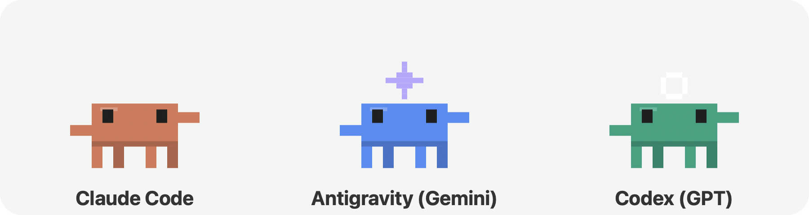
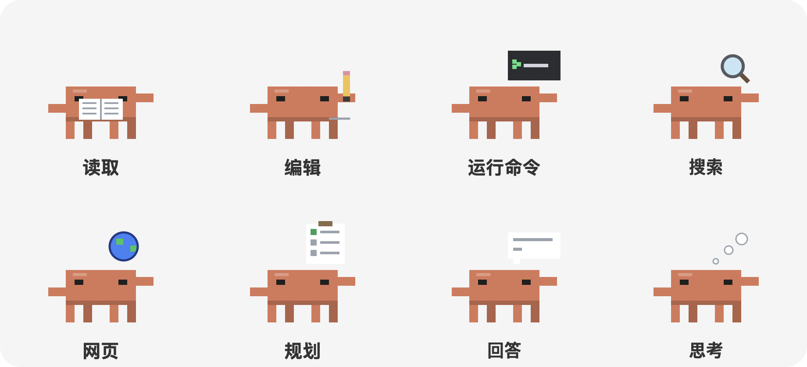
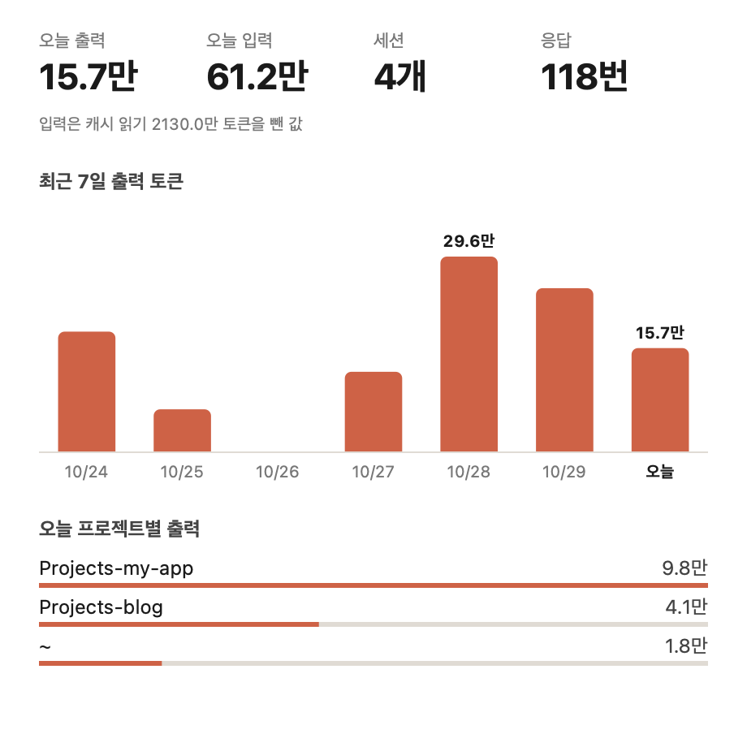
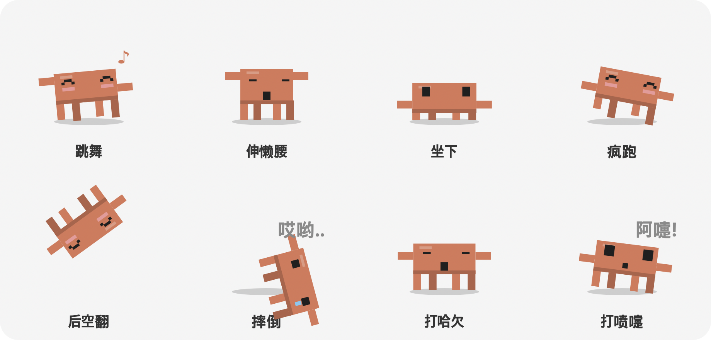

# Claude Buddy

[한국어](README.md) | [English](README.en.md) | [日本語](README.ja.md) | **简体中文** | [Español](README.es.md)

> 一只在屏幕上走来走去、同时告诉你 **Claude Code、Codex 和 Antigravity 此刻在做什么** 的 macOS 桌面宠物



一个以 Claude 吉祥物为灵感的像素风角色，会在屏幕底部和其他应用窗口的顶部走来走去。Claude Code 开始工作时，它会在头顶显示当前任务；子代理运行时，会跑出小角色一起干活。你还可以摸摸它、把它扔出去、和它玩球、喂零食，或者一起用专注计时器。向它提问，它会通过你已登录的 Claude、Codex 或 Antigravity CLI 简短回答。界面支持 한국어、English、日本語、简体中文 和 Español。

---

## 目录

1. [功能](#功能)
2. [系统要求](#系统要求)
3. [安装与运行](#安装与运行)
4. [自行构建](#自行构建)
5. [使用方法](#使用方法)
6. [设置](#设置)
7. [向 AI 提问](#向-ai-提问)
8. [工作原理](#工作原理)
9. [项目结构](#项目结构)
10. [隐私与数据](#隐私与数据)
11. [故障排除](#故障排除)
12. [已知限制](#已知限制)
13. [致谢](#致谢)

---

## 功能

### 1. 实时显示 AI 代理的工作
- 角色头顶的小标签会显示 Claude Code 正在做什么。

  | 标签示例 | 含义 | 角色动画 |
  |---|---|---|
  | `收到新请求`、`思考中` | 新消息、推理或处理工具结果 | 思考气泡里的小点 |
  | `正在读取 · buddy.py (从第 120 行)` | 读取文件 | 看书、翻页 |
  | `正在编辑 · buddy.py`、`正在写入 · new.py` | 编辑文件、新建文件 | 用铅笔画线 |
  | `正在运行 · (命令说明)` | 运行终端命令 | 小终端里光标闪烁 |
  | `搜索代码 · 'pattern'`、`正在查找文件 · *.py` | 搜索代码或文件 | 放大镜转圈 |
  | `网页搜索 · (搜索词)`、`正在读取网页 · github.com` | 网页搜索、阅读网页 | 地球仪旋转 |
  | `正在规划` | 更新待办列表 | 在清单上打勾 |
  | `正在撰写回答` | 撰写回复 | 对话气泡里逐渐出现文字 |
  | `子代理 · (任务名)` | 调用子代理 | 思考气泡里的小点 |
  | `需要确认 · 请回答问题`、`需要确认 · 需要授权` | 等待你的回答或授权 | 向你挥手并发送通知 |
  | `完成` | 任务结束(显示 8 秒) | 蹦一下 |

  

  标签左侧的圆点在工作时是橙色，完成后变成绿色。

- 工作中的角色会原地打字，并像上表那样展示**与任务类型对应的道具动画**。如果一个步骤超过 10 秒，标签后会加上已用时间(`· 20秒`、`· 2分钟`)。Codex 和 Antigravity 的角色也一样。
- **省电**:只有走路或跳跃时以 60fps 绘制，静止时 20fps，隐藏时 2fps；画面没有变化就不重绘。
- **"需要确认"提醒**:当 Claude Code 在等你回答问题(AskUserQuestion、计划审批)时，角色会挥手、显示"请确认!"，并用提示音和 macOS 通知提醒你。等待授权不会写入会话日志，所以当编辑、写入或网页抓取工具超过 8 秒没有结果时，就视为在等待授权。Shell 命令(Bash)本来就可能运行很久，因此不计入。
- **长任务完成通知**:耗时超过 1 分钟的任务结束时，即使你在看别的应用，也会收到 macOS 通知。
- **用量窗口**:在菜单中选择 **查看用量…**，会打开一个窗口，显示今天的输出和输入 token、会话数、回复数、最近 7 天输出 token 的柱状图(把鼠标放在柱子上可看到准确数值)，以及按项目统计的今日输出。它只是把会话日志里的 usage 字段加起来，不会发送到任何地方。

  
- **每个运行中的子代理都会出现一个小角色**(最多 6 个)。每个小角色在头顶显示自己的任务，在主角色旁边工作。子代理完成后，它会喊"完成!"、跳一下，然后走出屏幕。
- 点击小角色，可以在对话气泡里看到该子代理的任务和当前状态。
- **其他 AI 代理也会显示。** 它们工作时，各自的角色会出现在主角色旁边展示任务，完成后离开。不需要 API 密钥，只读取这些工具在你 Mac 上留下的活动日志。

  | 代理 | 角色 | 读取的日志 | 显示内容 |
  |---|---|---|---|
  | Claude Code | 橙色(主角色) | `~/.claude/projects/` 会话 JSONL | 读取和编辑文件、命令、搜索、子代理等 |
  | Codex (GPT) | 绿色身体 + 白色圆环 | `~/.codex/sessions/` 会话 JSONL | 新请求、思考、运行命令、编辑文件、撰写回答 |
  | Antigravity (Gemini) | 蓝色身体 + 紫色闪光 | `~/.gemini/antigravity-cli/log/`、`~/.gemini/antigravity/log/` | 新请求、工具步骤、完成 |

### 2. 角色的行为
- **60fps 动画**:走路时身体前倾、双腿交替抬起，落地时先压扁再伸展。视线和倾斜也会平滑跟随。
- **表情**会随情况变化:普通、眨眼、开心(^ ^ 加腮红)、惊讶、疼(流泪)、困、专注、睡着。
- **自己会做的事**:除了走路、休息、四处张望、打瞌睡和跳上其他窗口，它还会穿插下面这些动作。夜里打哈欠和睡觉更多，冲刺和后空翻更少。

  | 动作 | 样子 |
  |---|---|
  | 跳舞 | 交替举起双臂、摇摆，冒出音符 |
  | 伸懒腰 | 闭上眼睛举起双臂，把身体拉长 |
  | 坐下 | 放低身体坐下，时不时眨眼 |
  | 冲刺 | 以平时 3 倍的速度奔跑 |
  | 后空翻 | 跳起来在空中翻一整圈再落地 |
  | 摔倒 | 向前扑倒，说"哎哟.."后爬起来 |
  | 打哈欠 | 张大嘴巴，微微抬起双臂 |
  | 打喷嚏 | 先吸一口气，然后"阿嚏!"向前一冲 |

  
- **在窗口上走**:把其他应用窗口的顶边当作平台，有时会从边缘掉下去。被其他窗口挡住的部分不会使用。
- **多显示器**:在所有连接的屏幕之间漫游。
- **始终置顶**:无论哪个应用在前面、在哪个桌面(空间)都能看到。背景完全透明。

### 3. 互动

| 操作 | 反应 |
|---|---|
| 单击 | 摸摸(爱心) |
| 双击 | 摸摸(爱心 + 蹦一下) |
| 悬停 2.5 秒 | 摸摸 |
| 把光标靠近 | 停下来看着光标挥手 |
| 拖动 | 拎起来(双腿晃荡、惊讶表情) |
| 拖动后松开 | 扔出去。会在墙壁和地面反弹，摔得重时说"哎哟.." |
| 右键 | 打开菜单(菜单打开时角色不动) |

**菜单**(右键或菜单栏图标)

| 菜单项 | 作用 |
|---|---|
| 提问… | 输入问题，由 Claude、Gemini 或 GPT 简短回答(见[向 AI 提问](#向-ai-提问)) |
| 查看用量… | 显示今天和最近 7 天 Claude Code token 用量的窗口 |
| 喂零食 | 光标处掉下一块饼干，角色跑过来吃。饼干可以拖动 |
| 玩球 | 扔出球后它会追过去，把球叼回光标附近，再等你扔下一次 |
| 跟随光标 | 跟着光标走，光标在窗口上时会跳上去 |
| 专注计时 (25 分钟) | 在头顶显示剩余时间陪你专注，结束后建议休息 |
| 休息 30 分钟 | 睡 30 分钟 |
| 设置 | 见[设置](#设置) |

### 4. 日常反应
- **离开电脑**:5 分钟没有输入就会睡着，你回来时会说"欢迎回来!"。
- **休息提醒**:连续使用 50 分钟不休息，会提醒你伸展一下。
- **深夜**:凌晨 0 点到 5 点会显得很困，并建议你今天就到这里，每晚一次。

### 5. 便利功能
- **菜单栏图标**:与右键菜单功能相同，另外还有 Claude Code 当前的待办列表和 **隐藏/显示角色**。
- **全屏时自动隐藏**:前台应用全屏(视频、演示)时自动隐藏，结束后回来。
- **音效**:点击、吃东西、接住、完成等时刻会播放简短的系统音效，可在设置中关闭。
- **没有 Dock 图标**:只显示菜单栏图标。

---

## 系统要求

- **macOS**，**Apple Silicon(M1 及以上)**。发布版本仅支持 arm64。Intel Mac 请[自行构建](#自行构建)。
- 发布的应用已内置 Python 和全部依赖，无需另外安装。
- 自行构建需要 **Python 3.10 或以上**，依赖由 `build.sh` 安装。
  - `pyobjc-framework-Cocoa`:透明置顶窗口、绘图、菜单栏
  - `pyobjc-framework-Quartz`:其他应用的窗口位置、输入空闲时间
  - `anthropic`:(可选)使用 API 密钥获取 Claude 回答
  - `certifi`:打包应用中的 HTTPS 证书校验

---

## 安装与运行

### 1. 下载

从 [Releases](https://github.com/Junseung0526/claude-buddy/releases/latest) 下载 `Claude-Buddy-macOS-arm64.zip` 并解压。

### 2. 移到"应用程序"

把 `Claude Buddy.app` 拖到"应用程序"文件夹。

### 3. 首次运行时允许

该应用没有使用 Apple 开发者证书签名或公证，所以首次运行会被 macOS 拦截。请用以下任一方式允许。

- **方法 1(系统设置)**:先打开一次应用并关闭警告，然后在 **系统设置 → 隐私与安全性** 底部点击 **仍要打开**。
- **方法 2(终端)**:移除下载隔离属性。

  ```bash
  xattr -dr com.apple.quarantine "/Applications/Claude Buddy.app"
  ```

### 4. 启动与退出

- 双击 `Claude Buddy.app`，角色会出现，菜单栏也会出现图标。它不会出现在 Dock 中。
- 要退出，右键点击角色或菜单栏图标，选择 **退出**。
- 如需登录时自动启动，请自行在 **系统设置 → 通用 → 登录项** 中添加(默认不添加)。

---

## 自行构建

可以直接从源码运行，也可以自己构建应用。

```bash
git clone https://github.com/Junseung0526/claude-buddy.git
cd claude-buddy
./build.sh
```

`build.sh` 会:
1. 创建 `.venv` 虚拟环境(优先使用 `python3.14`，否则用 `python3`)
2. 安装 `requirements.txt` 中的依赖和 PyInstaller
3. 绘制角色并生成应用图标(`.icns`)
4. 用 PyInstaller 构建内置 Python 的 **`dist/Claude Buddy.app`**(仅菜单栏应用，ad-hoc 签名)
5. 生成用于发布的 **`dist/Claude-Buddy-macOS-<架构>.zip`**

可以用 `VERSION=1.1.0 ./build.sh` 指定版本。不构建直接运行:

```bash
.venv/bin/python buddy.py          # 或 .venv/bin/python -m claude_buddy
```

---

## 使用方法

1. 启动后，角色会出现在屏幕底部并开始走动。
2. 当你用 Claude Code、Codex 或 Antigravity 开始工作时，角色会停下手头的事，展示进度。
3. 想问问题时，选择 **右键 → 提问…**，输入问题后按 `Enter`。按 `Esc` 关闭。回答会显示在对话气泡中，25 秒后自动关闭，并附有"此回答由 AI 生成，可能有误"的提示。

---

## 设置

在菜单的 **设置** 中修改。设置保存在 `~/Library/Application Support/Claude Buddy/settings.json`，下次启动时保留。

| 设置 | 键 | 选项 | 默认值 |
|---|---|---|---|
| 大小 | `scale` | 小 / 中 / 大 | 中(`6`) |
| 行走速度 | `speed` | 慢 / 中 / 快 | 中(`55`) |
| 声音 | `sound` | 开 / 关 | 开 |
| 通知(需要确认、长任务完成) | `notify` | 开 / 关 | 开 |
| 语言 | `lang` | 跟随系统(`auto`) / 한국어(`ko`) / English(`en`) / 日本語(`ja`) / 简体中文(`zh`) / Español(`es`) | 系统语言(在加入语言功能之前就在使用的人为韩语) |
| 爬到窗口上 | `windows` | 开 / 关 | 开 |
| 显示代理工作 | `activity` | 开 / 关 | 开 |
| 回答模型 | `ask_provider` | Claude / Gemini / GPT | Claude(`claude`) |

也可以直接编辑 `settings.json`(重启后生效)。

```json
{
 "scale": 6,
 "speed": 55,
 "sound": true,
 "windows": true,
 "activity": true,
 "notify": true,
 "lang": "zh",
 "ask_provider": "claude"
}
```

---

## 向 AI 提问

此功能为可选。**提问** 会按以下顺序寻找回答方式。

| 情况 | 行为 |
|---|---|
| **已登录所选模型的 CLI**(默认) | CLI 用你选择的语言在 3 句话内回答，无需 API 密钥 |
| 没有 CLI，但 **已设置 API 密钥** | 以同样方式直接调用 API |
| 两者都没有 | 提示你需要登录或填写密钥 |

通过 CLI 回答会计入你的订阅用量，并且因为要启动 CLI，需要 5–10 秒。不使用任何工具，也不保留会话日志，因此提问不会显示为代理的工作。

| 选择 | 使用的 CLI | 登录 |
|---|---|---|
| Claude | `claude -p`(Haiku) | Claude Code 登录 |
| Gemini | `agy -p` | Antigravity 登录 |
| GPT | `codex exec` | Codex 登录 |

CLI 会在 `PATH`、`~/.local/bin`、`/opt/homebrew/bin` 和 `/usr/local/bin` 中查找。

### 选择回答模型

在 **设置 → 回答模型** 中选择。下表中的模型是在没有 CLI 时用 API 密钥调用的模型，都是适合简短回答的低成本模型。

| 选择 | 模型 | 获取密钥 |
|---|---|---|
| Claude | `claude-haiku-5-5` | [Anthropic Console](https://console.anthropic.com/) |
| Gemini | `gemini-flash-lite-latest` | [Google AI Studio](https://aistudio.google.com/apikey) |
| GPT | `gpt-5-mini` | [OpenAI Platform](https://platform.openai.com/api-keys) |

### 设置 API 密钥(仅在没有 CLI 时)

先选择模型，然后选择 **设置 → 设置 (模型) API 密钥…**，粘贴密钥后按 `Enter`。输入时密钥会被隐藏。

- 密钥按模型保存在 **macOS 钥匙串**(服务名 `Claude Buddy`)中，而不是设置文件里。无需重启。
- 用 **更改 API 密钥…** 替换密钥，用 **删除 API 密钥** 移除。
- 先在环境变量(`ANTHROPIC_API_KEY`、`GEMINI_API_KEY`、`OPENAI_API_KEY`)中查找密钥，再查钥匙串。

### 节省费用的设置

- 每次回答最多 400 个 token
- Claude:关闭扩展思考，effort `low`
- GPT:reasoning effort `minimal`

- 如果请求失败(网络、认证、拒绝、模型改名等)或回复为空，会提示没有获得回答。
- 使用 API 可能会产生各服务商的费用。

---

## 工作原理

### 透明置顶窗口
角色、对话气泡、玩具和状态标签都是 **无边框的透明 `NSWindow`**。它们位于 `NSStatusWindowLevel`，并加入所有空间和全屏辅助区域，所以不会被其他应用挡住。

> 第一个版本使用 tkinter(Tk 9)，但在 macOS 上透明背景会变成黑色，窗口还会躲到其他应用后面，所以改用了 PyObjC(Cocoa)。

### 检测 Claude Code 的工作
Claude Code 会把会话日志写成 JSONL 文件。Buddy **不碰设置或钩子，只读取这些文件**。

```
~/.claude/projects/<项目>/<会话 ID>.jsonl              ← 主会话日志
~/.claude/projects/<项目>/<会话 ID>/subagents/
    agent-<ID>.jsonl                                   ← 子代理日志
    agent-<ID>.meta.json                               ← {"description": ..., "finished": true|false}
```

1. 每秒在最近 15 分钟内有变化的会话文件中选出**最新的一个**。
2. 只读取末尾新追加的行(tail)，根据 `tool_use`、`tool_result`、思考和回答块确定当前标签。
3. 只要还有工具在等待结果，或者距最后一条记录不到 25 秒，就视为"工作中"。
4. 子代理根据 `subagents/*.meta.json` 中的 `finished` 值出现和结束。

### 在窗口上走
每 0.4 秒用 Quartz 的 `CGWindowListCopyWindowInfo` 读取可见普通窗口的位置。顶边中**没有被前面窗口挡住的部分**才会用作平台。贴着菜单栏的最大化窗口和很小的窗口会被跳过。该 API 不读取窗口标题，因此**不需要屏幕录制权限**。

### 物理
所有角色和玩具使用相同的重力(2200 pt/s²)。落地冲击决定反弹、压扁程度和疼痛表情。要去不同高度的目标时，会计算抛物线跳跃，向上跳或向下跳。

---

## 项目结构

```
claude-buddy/
├── buddy.py              # 入口(源码运行和 PyInstaller 构建共用)
├── claude_buddy/         # 主包
│   ├── __main__.py       # main():启动应用，--icon 选项(python -m claude_buddy)
│   ├── app.py            # Buddy:总体协调(每帧处理、行为、对话气泡、提问)
│   ├── config.py         # 路径、默认设置、物理常量、保存设置
│   ├── activity.py       # 跟踪 Claude Code、Codex、Antigravity 日志 → 任务标签
│   ├── world.py          # 屏幕区域、窗口平台、全屏检测
│   ├── critter.py        # 角色的绘制、物理和动作(主角色和小角色)
│   ├── toy.py            # 零食和球
│   ├── widgets.py        # 对话气泡、按钮、状态标签、用量窗口
│   ├── menu.py           # 菜单结构和菜单操作
│   ├── usage.py          # Claude Code token 用量(按天和项目汇总会话日志中的 usage)
│   ├── i18n.py           # 界面翻译(한국어、English、日本語、简体中文、Español)
│   ├── llm.py            # 提问的回答模型(Claude、Gemini、GPT)和 API 密钥(钥匙串)
│   ├── gfx.py            # 颜色、绘图工具、透明窗口、标签、音效
│   └── icon.py           # 应用和菜单栏图标
├── build.sh              # 用 PyInstaller 构建独立应用(.app)和发布用 zip
├── requirements.txt      # 依赖
├── docs/                 # README 图片(每种语言一个文件夹)
├── THIRD_PARTY_NOTICES.md # 应用中附带的开源组件许可声明
├── README.md             # 韩语(README.en.md · README.ja.md · README.zh-CN.md · README.es.md)
└── .gitignore
```

模块依赖是单向的(没有循环)。

```
__main__ → app → menu, critter, toy, widgets, world, activity, usage, llm, icon → i18n, gfx, config
```

- 新的游戏或玩具加在 `toy.py`、`menu.py`(菜单项)和 `app.py`(反应)中。
- 角色的外观和表情在 `critter.py` 的 `draw_critter` 中修改，行为在 `app.py` 的 `brain` 中修改。
- 新设置加到 `config.py` 的 `DEFAULTS` 和菜单(`menu.py`)中。
- 界面文字用 `t("韩语原文")` 包起来，并在 `i18n.py` 的 `TR` 中加入英语、日语、中文和西班牙语翻译。运行 `python -m claude_buddy.i18n` 可检查漏译和占位符不一致。

运行时生成的文件(不在仓库中):

| 文件 | 内容 |
|---|---|
| `~/Library/Application Support/Claude Buddy/settings.json` | 用户设置 |
| `.venv/` | 虚拟环境(自行构建时) |
| `build/`、`dist/` | PyInstaller 产物 |

---

## 隐私与数据

- 所有处理都**只在你的 Mac 上**进行。
- Claude Code 会话日志**只读取**，不会发送或保存到任何地方。屏幕上只显示工具名和文件名等少量信息。
- 唯一的对外通信，是把你在"提问"中输入的问题，通过 CLI 或 API 密钥发送给你选择的公司(Anthropic、Google 或 OpenAI)。
- 没有账号和注册，也没有使用统计、广告或追踪代码。
- 留下的数据只有设置文件和钥匙串中的 API 密钥。要清除，请删除 `~/Library/Application Support/Claude Buddy` 文件夹，并使用菜单中的 **删除 API 密钥**(或在"钥匙串访问"中删除 `Claude Buddy` 项)。
- 屏幕共享时任务标签(文件名等)可能会被看到，必要时请用菜单栏图标 → **隐藏角色**。

---

## 故障排除

| 问题 | 解决方法 |
|---|---|
| 因"无法验证开发者"警告打不开 | 见[首次运行时允许](#3-首次运行时允许)。 |
| 双击应用没有反应 | 在终端运行 `"/Applications/Claude Buddy.app/Contents/MacOS/Claude Buddy"` 查看错误信息。 |
| 不显示代理的工作 | 检查设置中"显示代理工作"是否打开，以及最近 15 分钟内是否有活动的会话。 |
| 提问后 AI 不回答 | 检查是否已登录所选模型的 CLI(`claude`、`codex`、`agy`)，或 API 密钥是否正确。见[向 AI 提问](#向-ai-提问)。 |
| 看不到角色 | 可能有全屏应用在前台，或在菜单栏图标中隐藏了角色。 |
| 太常爬到窗口上 | 在设置中关闭"爬到窗口上"。 |

---

## 已知限制

- 仅支持 macOS，发布的应用仅支持 Apple Silicon。
- 未经 Apple 公证，首次启动需要手动允许。
- 无法判断你是否在共享屏幕，需要时请手动隐藏。
- 每个代理只跟踪**最近活动的一个会话**。
- 暂不支持 Gemini CLI。Antigravity 只能显示日志中记录的内容，所以显示的是步骤编号，而不是正在使用哪个工具。
- 如果会话日志格式发生变化，任务标签可能不准确。
- 提问不会记住之前的对话，一次只回答一个问题。

---

## 致谢

- 角色:受 Anthropic 的 Claude 吉祥物启发的粉丝自制像素画，与 Anthropic 没有官方关系。
- "Claude"是 Anthropic 的商标。Codex 是 OpenAI 的产品，Antigravity 和 Gemini 是 Google 的产品。本项目是非官方的粉丝项目，未获得上述任何公司的认可或赞助。
- 应用中附带的开源组件及其许可证列在 [THIRD_PARTY_NOTICES.md](THIRD_PARTY_NOTICES.md) 中(也包含在应用内的 `Contents/Resources` 中)。
